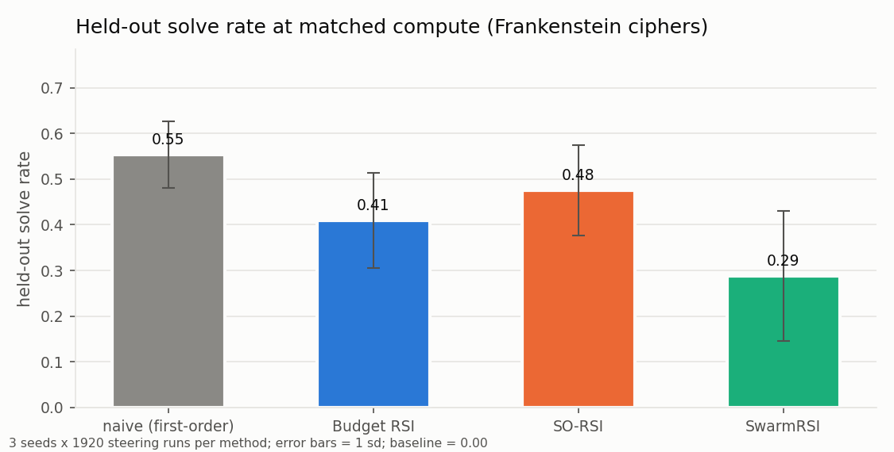
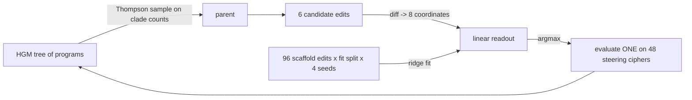
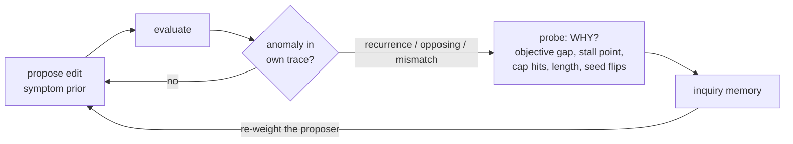
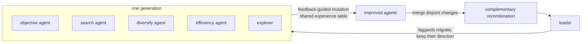
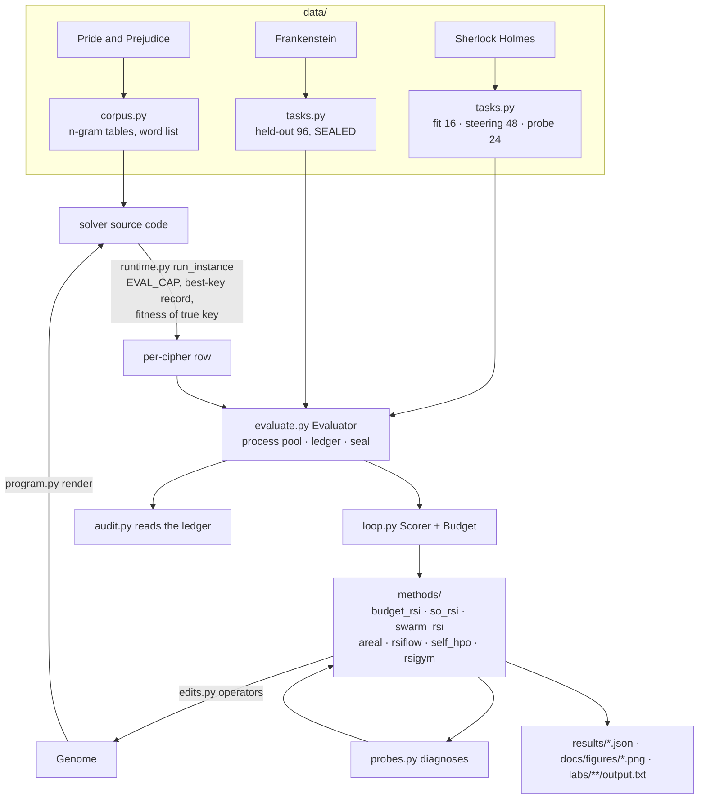

# RSI Research Studio — Assignment 5: CipherSmith, a self-improving cipher breaker

A program that breaks substitution ciphers, and **three October 2026 recursive-self-improvement methods** that
improve that program — **Budget RSI**, **SO-RSI** and **SwarmRSI** — rebuilt from their mechanisms, run on real
text, compared at matched compute, and audited. All **17 codelabs of section 10** of the
[RSI course map](https://github.com/dlmastery/simple-coding-harness/blob/main/COURSE-MAP.md#theme-10) are
implemented on this one problem, plus a finale that puts the three methods head to head.

Author: **nitishsjsucs** · SJSU · November 2026 · Reference course: [dlmastery/simple-coding-harness](https://github.com/dlmastery/simple-coding-harness) (theme 10, *Read and rebuild October 2026 research*)



**Bottom line (finale, 3 seeds × 1,920 steering runs each, audited):** every method turns a program that solves
**0%** of unseen Frankenstein ciphers into one that solves **29–55%**, and each mechanism behaves as its paper describes
*relative to its own ablation*. Budget RSI's diff readout roughly doubles held-out over random selection (0.410 vs 0.215).
SO-RSI's probes recommend the edit that actually helps in 3 of 3 checks. The swarm wins when sequential rounds are the
constraint. But **at matched compute none of the three beats a plain first-order loop on held-out (0.554)** in this
domain. The [finale](labs/06_finale/three_methods_showdown/README.md) explains why, and
[what went wrong](#what-went-wrong-and-what-it-taught) lists six bugs the runs exposed on the way.

**Verified in this repo:** 18/18 labs run end to end (`run_all.py`: 47 min full, ~4 min `--quick`) · 35 unit tests pass ·
the finale's ledger audit passes all four rules · every number below is copied from a committed `output.txt`.

---

## Contents

1. [The problem](#the-problem-why-a-cipher-breaker)
2. [What "recursive" means here](#what-recursive-means-here-three-objects)
3. [The three methods](#the-three-methods)
4. [The 17 codelabs](#the-17-codelabs)
5. [Quick start](#quick-start)
6. [Architecture](#architecture)
7. [Results](#results)
8. [What we can and cannot claim](#what-we-can-and-cannot-claim)
9. [What went wrong, and what it taught](#what-went-wrong-and-what-it-taught)
10. [Fairness: the evaluation protocol](#fairness-the-evaluation-protocol)
11. [Testing](#testing)
12. [Videos](#videos)
13. [Repository layout](#repository-layout)
14. [Limitations](#limitations)
15. [Credits](#credits)

---

## The problem: why a cipher breaker

A **monoalphabetic substitution cipher** replaces every letter with another (`the` → `fgz`). Breaking one means
searching 26! ≈ 4×10²⁶ keys for the one that turns the ciphertext into English. A *solver program* does it with
two parts: an **objective** (how English-like is this decryption? letter n-gram statistics, optionally a
dictionary) and a **search** (start somewhere, swap letters, keep what scores better).

```text
$ T="the detective looked at the strange marks on the door and said that the thief had come in through the window before the rain began"
# (the CLI prints one JSON object; shown here one field per line, long lines cut)

$ python3 -m cipherlab.cli solve --genome '{}' --text "$T"          # the baseline: 2-gram, random start, 1 x 1,000 swaps
  ciphertext: fgz lzfzkfqoz vuudzl tf fgz hfntayz itndh ua fgz luun tal htql fgtf fgz fgqzc gtl kuiz qa ...
  decrypt   : hat rthtchopt veentr sh hat dhisfmt ysind ef hat reei sfr dsor hash hat haotl asr ceyt of ...
  acc       : 0.019

$ python3 -m cipherlab.cli solve --genome '{"ngram":4,"word_weight":2.0,"init":"frequency","search":"anneal","temp0":10.0,"iters":5000,"restarts":4}' --text "$T"
  decrypt   : the detective looked at the strange marks on the door and said that the thief had come in through the window before the rain began
  acc       : 1.0
```

Why this is a good testbed for RSI (and not just a puzzle):

| Property | Why it matters for RSI |
|---|---|
| **The improved object is a program.** A [`Genome`](cipherlab/program.py#L30) renders to real Python source ([`render()`](cipherlab/program.py#L83)); edits are source diffs. | Budget RSI scores *diffs*; SO-RSI diagnoses *programs*; SwarmRSI *recombines* program modules. |
| **Exact, cheap evaluation.** A cipher is solved when ≥ 90% of letters are right; one evaluation of 48 ciphers takes 0.1–3 s on 10 cores. | Hundreds of candidate programs per lab on a laptop, with seeds. |
| **A long ladder.** The baseline solves **0%**; good programs reach **~60–70%** within the same per-cipher budget. Short ciphers (40–80 chars) are information-limited and stay hard. | Room to improve, and a ceiling to reason about. |
| **Failures have mechanisms you can observe.** For every cipher the harness records whether the program's *own* objective prefers a wrong key over the true one, where the search stalled, and whether it hit the evaluation cap. | SO-RSI's probes need *why*, not just *how much*. |
| **Honest held-out data.** The language model is built from *Pride and Prejudice*; steering ciphers come from *Sherlock Holmes*; the sealed held-out ciphers come from *Frankenstein* ([data/NOTICE.md](data/NOTICE.md)). | "Unseen text" means a different author, era and vocabulary. |

## What "recursive" means here: three objects

Course theme 09 separates three objects; this repo keeps them in separate code:

| Object | In this repo | Changed by |
|---|---|---|
| **Task model** — the thing that does the task | a solver program: [`program.py`](cipherlab/program.py) renders it, [`runtime.py`](cipherlab/runtime.py) runs it under a fixed per-cipher budget (`EVAL_CAP = 20,000` candidate keys) | every improver, through [edit operators](cipherlab/edits.py) |
| **Research loop** — proposes edits and keeps or discards them | propose → [score on steering](cipherlab/loop.py#L65) → keep if it [beats](cipherlab/loop.py#L43) the parent | — |
| **Improver** — the rules that govern the research loop | *which* edits to evaluate (Budget RSI readout), *how* to choose edits given evidence (SO-RSI inquiry memory), *who* proposes and how results are shared (SwarmRSI, AReaL), *which stages run* (RSIFlow), *which half of the program* is optimised (Self-HPO) | the methods in [`cipherlab/methods/`](cipherlab/methods), several of which revise themselves while running |

## The three methods

The assignment asks for three state-of-the-art RSI methods. We chose the three October 2026 methods that
section 10 of the course builds around, so every lab maps one-to-one onto the course map. (They are close
relatives of the suggested examples: Budget RSI's tree search is in the AIDE family of tree search over code;
SwarmRSI and AReaL-RSI are multi-agent scientist systems in the AI-Scientist family.)

### 1 · Budget RSI — score code edits before they run (arXiv:2610.29121)



Evaluating an edit is the expensive step, so a linear readout trained once on 96 labelled edits reads each
candidate's **unified diff** (lines added/deleted, hunks, functions added/removed, imports, constants,
control-flow lines) and only the best-scored candidate is run. Parents come from a Huxley–Gödel Machine tree:
Thompson sampling on the pooled solve counts of a node and all its descendants.
Code: [`methods/budget_rsi.py`](cipherlab/methods/budget_rsi.py) · Labs: [10.03](labs/01_budget_rsi_scoring/10_03_run_budget_rsi/README.md), [10.04](labs/01_budget_rsi_scoring/10_04_analyze_scoring/README.md), [10.05](labs/01_budget_rsi_scoring/10_05_extend_readout/README.md)

### 2 · SO-RSI — second-order diagnostic inquiry (arXiv:2610.05701)



The first-order loop patches the symptom ("score is low → search harder"). SO-RSI runs the *same* proposer and
acceptance rule but watches its own trace for three anomalies, buys a probe (from the same budget) when one
fires, and keeps an inquiry memory that steers proposals toward edits that address the diagnosed mechanism.
The key probe compares the fitness of the key the program found with the fitness of the **true** key: if the
program's own objective prefers the wrong answer, no amount of search can help.
Code: [`methods/so_rsi.py`](cipherlab/methods/so_rsi.py), [`probes.py`](cipherlab/probes.py) · Labs: [10.06](labs/02_second_order_diagnostics/10_06_run_so_rsi/README.md), [10.07](labs/02_second_order_diagnostics/10_07_analyze_probes/README.md), [10.08](labs/02_second_order_diagnostics/10_08_apply_to_debugging/README.md)

### 3 · SwarmRSI — an evolving swarm of research agents (arXiv:2610.20431)



Five agents with distinct research directions and written hypotheses each try one edit per generation,
re-weighted by a shared experience table; improvements found in parallel on *different* parts of the program are
merged; each agent's own proposal distribution is revised by what worked (the recursive part).
Code: [`methods/swarm_rsi.py`](cipherlab/methods/swarm_rsi.py) · Labs: [10.09](labs/03_scaling_coordination/10_09_compare_scaling/README.md), [10.11](labs/03_scaling_coordination/10_11_swarm_rsi/README.md)

The other four mechanisms in section 10 are built on the same engine: **AReaL-RSI** (leader, researchers,
conditional memory: [10.10](labs/03_scaling_coordination/10_10_areal_leader_follower/README.md)), **RSIFlow**
(a meta-agent that rewires the workflow: [10.13](labs/04_adaptive_workflows/10_13_rsiflow_meta_agent/README.md)),
**Self-HPO** (harness/policy alternation: [10.14](labs/04_adaptive_workflows/10_14_self_hpo/README.md)) and
**RSIGym** (Everything-as-a-Service, tracks, RSI-Index: [10.15](labs/05_environments_metrics/10_15_rsi_index/README.md)).

## The 17 codelabs

Every lab is one script (`lab.py`), a README with a code walkthrough that links to exact lines, the real output
of a full run (`output.txt`, also embedded in the README) and a quiz. `--quick` runs any lab in under a minute.

| Lab | Course group | Question | Paper | Full run |
|---|---|---|---|---|
| [10.01](labs/00_reading_frontier_research/10_01_claim_vs_evidence/README.md) Claim vs evidence | 00 Read a frontier claim | Does the best score after selection survive re-measurement? | all three | [output](labs/00_reading_frontier_research/10_01_claim_vs_evidence/output.txt) |
| [10.02](labs/00_reading_frontier_research/10_02_audit_paper/README.md) Audit a paper | 00 | What did the experiment measure, and can a ledger prove it? | all three | [output](labs/00_reading_frontier_research/10_02_audit_paper/output.txt) |
| [10.03](labs/01_budget_rsi_scoring/10_03_run_budget_rsi/README.md) Run Budget RSI | 01 Budget RSI | Does scoring edits before running them buy better programs? | Budget RSI | [output](labs/01_budget_rsi_scoring/10_03_run_budget_rsi/output.txt) |
| [10.04](labs/01_budget_rsi_scoring/10_04_analyze_scoring/README.md) Analyse the scoring | 01 | Which diff features predict a better program? What can a diff not see? | Budget RSI | [output](labs/01_budget_rsi_scoring/10_04_analyze_scoring/output.txt) |
| [10.05](labs/01_budget_rsi_scoring/10_05_extend_readout/README.md) Extend the readout | 01 | Signed coordinates, compound edits, training distribution | Budget RSI | [output](labs/01_budget_rsi_scoring/10_05_extend_readout/output.txt) |
| [10.06](labs/02_second_order_diagnostics/10_06_run_so_rsi/README.md) Run SO-RSI | 02 Second-order RSI | Does asking *why* beat patching symptoms at the same cost? | SO-RSI | [output](labs/02_second_order_diagnostics/10_06_run_so_rsi/output.txt) |
| [10.07](labs/02_second_order_diagnostics/10_07_analyze_probes/README.md) Analyse probes | 02 | When does each anomaly fire? Do probe recommendations win? | SO-RSI | [output](labs/02_second_order_diagnostics/10_07_analyze_probes/output.txt) |
| [10.08](labs/02_second_order_diagnostics/10_08_apply_to_debugging/README.md) Apply to debugging | 02 | Is the function wrong, or the test? | SO-RSI | [output](labs/02_second_order_diagnostics/10_08_apply_to_debugging/output.txt) |
| [10.09](labs/03_scaling_coordination/10_09_compare_scaling/README.md) Compare scaling | 03 Scaling RSI | How do a leader-led team and a peer swarm spend one budget? | AReaL-RSI, SwarmRSI | [output](labs/03_scaling_coordination/10_09_compare_scaling/output.txt) |
| [10.10](labs/03_scaling_coordination/10_10_areal_leader_follower/README.md) Leader-follower | 03 | Share only replicated findings, everything, or nothing? | AReaL-RSI | [output](labs/03_scaling_coordination/10_10_areal_leader_follower/output.txt) |
| [10.11](labs/03_scaling_coordination/10_11_swarm_rsi/README.md) Swarm evolution | 03 | What do mutation, recombination, sharing each add? | SwarmRSI | [output](labs/03_scaling_coordination/10_11_swarm_rsi/output.txt) |
| [10.12](labs/04_adaptive_workflows/10_12_compare_workflows/README.md) Compare workflows | 04 Adaptive workflows | Which object does each method adapt? | RSIFlow, Self-HPO | [output](labs/04_adaptive_workflows/10_12_compare_workflows/output.txt) |
| [10.13](labs/04_adaptive_workflows/10_13_rsiflow_meta_agent/README.md) RSIFlow meta-agent | 04 | Does a self-rewiring workflow beat a fixed one? | RSIFlow | [output](labs/04_adaptive_workflows/10_13_rsiflow_meta_agent/output.txt) |
| [10.14](labs/04_adaptive_workflows/10_14_self_hpo/README.md) Self-HPO | 04 | Is harness + policy worth more than the sum? | Self-HPO | [output](labs/04_adaptive_workflows/10_14_self_hpo/output.txt) |
| [10.15](labs/05_environments_metrics/10_15_rsi_index/README.md) RSI-Index | 05 Environments & metrics | What fraction of the gap does each track close? | RSIGym | [output](labs/05_environments_metrics/10_15_rsi_index/output.txt) |
| [10.16](labs/05_environments_metrics/10_16_environments/README.md) Environments | 05 | EaaS vs terminal vs self-play: cost and capability | RSIGym, Terminal-RSI, R2Orch | [output](labs/05_environments_metrics/10_16_environments/output.txt) |
| [10.17](labs/05_environments_metrics/10_17_metrics/README.md) Metrics | 05 | What does each metric say about our runs, and hide? | all | [output](labs/05_environments_metrics/10_17_metrics/output.txt) |
| [Finale](labs/06_finale/three_methods_showdown/README.md) Three methods, one budget | — | Which procedure builds the best breaker on unseen text? | Budget RSI, SO-RSI, SwarmRSI | [output](labs/06_finale/three_methods_showdown/output.txt) |

## Quick start

Python 3.9+ with NumPy and Matplotlib (the system Python on macOS with those two packages is enough). No API
keys, no GPU, no network.

```bash
git clone https://github.com/nitishsjsucs/rsi-research-studio-assignment-5.git
cd rsi-research-studio-assignment-5
python3 -m pip install numpy matplotlib      # if you don't have them
python3 run_tests.py                         # 35 unit tests, ~1 s
python3 labs/02_second_order_diagnostics/10_06_run_so_rsi/lab.py --quick    # one lab, < 1 min
python3 run_all.py --quick                   # all 18 labs with small budgets, ~4 min
python3 run_all.py                           # the full runs whose outputs are committed
```

The harness is also a CLI ([`cipherlab/cli.py`](cipherlab/cli.py)): `render` prints a program's source, `solve`
breaks your own sentence, `evaluate` scores a program on a split (held-out refuses unless `--unseal`).

## Architecture



| Module | Lines | Role |
|---|---:|---|
| [`corpus.py`](cipherlab/corpus.py) | 88 | the language model: add-k smoothed letter n-grams and a 3,000-word dictionary, from one book |
| [`tasks.py`](cipherlab/tasks.py) | 129 | cipher instances and the four splits; deterministic per (split, seed) |
| [`program.py`](cipherlab/program.py) | 254 | `Genome` → Python source; `diff_features` (8) and `signed_features` (7) read from a unified diff |
| [`runtime.py`](cipherlab/runtime.py) | 122 | the fixed harness: budget cap, best-key record, crash-tolerant runs, true-key fitness for probes |
| [`evaluate.py`](cipherlab/evaluate.py) | 121 | parallel evaluation, per-split ledger, sealed held-out |
| [`edits.py`](cipherlab/edits.py) | 135 | 24 edit operators with kind, target, inverse and prior expected gain |
| [`probes.py`](cipherlab/probes.py) | 128 | diagnostic probes → mechanisms → remedies |
| [`loop.py`](cipherlab/loop.py) | 155 | `Scored`, `Budget`, `Scorer`, `Step`, `Trace`, result files |
| [`audit.py`](cipherlab/audit.py) | 37 | four rules read from the ledger |
| [`methods/`](cipherlab/methods) | 1,186 | the seven mechanisms |

## Results

One line per lab; each links to the lab, whose README has the full table and its interpretation.

| Lab | Finding (full runs, 3 seeds unless noted) |
|---|---|
| [10.01](labs/00_reading_frontier_research/10_01_claim_vs_evidence/README.md) | The best of 16 edits "gains" **+0.167** on the split used to select it; re-measured on fresh seeds: **+0.010**; on unseen ciphers: **+0.000**. |
| [10.02](labs/00_reading_frontier_research/10_02_audit_paper/README.md) | The ledger catches a held-out peek, a 2× budget and a single seed; the clean comparison passes (greedy 0.330 vs random 0.115 held-out). |
| [10.03](labs/01_budget_rsi_scoring/10_03_run_budget_rsi/README.md) | **Budget RSI readout 0.410** held-out vs parent-rate ablation 0.215 vs evaluate-all-6 oracle 0.247, all at 1,920 runs. |
| [10.04](labs/01_budget_rsi_scoring/10_04_analyze_scoring/README.md) | `lines_added` is the strongest diff signal; CV ranking r = +0.18; `iters_up` and `iters_down` have **identical** diff coordinates. |
| [10.05](labs/01_budget_rsi_scoring/10_05_extend_readout/README.md) | Signed coordinates: **0.453 ± 0.009** (vs 0.410 ± 0.127). Trained on shallow programs, the same readout falls to **0.099**, below its ablation. |
| [10.06](labs/02_second_order_diagnostics/10_06_run_so_rsi/README.md) | Same proposer, same budget: SO-RSI **reduces thrashing** (thrash anomalies 10.7 vs 14.7, mismatches 20 vs 43, rejected edits 21.7 vs 27.0) but trails on held-out (**0.476 vs 0.554**; it spends ~17% of its budget on probes). |
| [10.07](labs/02_second_order_diagnostics/10_07_analyze_probes/README.md) | On a real cipher the weak program's own objective prefers a wrong decryption; probe-recommended edits beat probe-"futile" edits **3/3**. |
| [10.08](labs/02_second_order_diagnostics/10_08_apply_to_debugging/README.md) | Recurrence, opposing and mismatch fire on a real debugging log; a contract probe shows the *test* was wrong; the "passing" fix broke the contract (0% hold). |
| [10.10](labs/03_scaling_coordination/10_10_areal_leader_follower/README.md) | Leader + two researchers: conditional memory 0.205 ≈ share-everything 0.208, both **below independent researchers (0.293)** at ~7 campaigns per run; the paper's sharing advantage is not reproduced at this budget. |
| [10.11](labs/03_scaling_coordination/10_11_swarm_rsi/README.md) | Swarm vs one agent: **0.288 vs 0.554** at equal compute, **0.288 vs 0.212** at equal sequential rounds; ablations within noise. |
| [10.13](labs/04_adaptive_workflows/10_13_rsiflow_meta_agent/README.md) | Adaptive workflow **0.575** vs static 0.554 held-out; the meta-agent switched one of its own rules off in every run. |
| [10.14](labs/04_adaptive_workflows/10_14_self_hpo/README.md) | Harness/policy alternation 0.500, harness only 0.474, policy only 0.208: the harness carries the gain; **no synergy** (+0.339 joint vs +0.359 sum). |
| [10.15](labs/05_environments_metrics/10_15_rsi_index/README.md) | RSI-Index: **joint 0.262 > data 0.006 + harness 0.132** (synergy here); the course's printed formula has its sign flipped. |
| [10.16](labs/05_environments_metrics/10_16_environments/README.md) | EaaS and terminal return the identical program; terminal costs 2× wall-clock (+0.27 s per evaluation); self-play's task choice stalls (0.297). |
| [Finale](labs/06_finale/three_methods_showdown/README.md) | Held-out: **naive 0.554**, SO-RSI 0.476, Budget RSI 0.410, SwarmRSI 0.288; RSI-Index 0.381 / 0.315 / 0.263 / 0.191. |

## What we can and cannot claim

**Supported by these runs** (one task family, 3 seeds, 1,920 steering runs per arm, sealed held-out):

- Each mechanism beats its own ablation where the ablation isolates it: diff-reading beats random selection inside the same tree
  (Budget RSI); the swarm beats one agent at equal sequential rounds; the joint RSIGym track beats data-only and harness-only combined.
- Probe recommendations identify the better of two edits (3/3 cases), and the objective-gap probe exposes failures that search cannot fix.
- Selection inflates headlines (10.01): a selected gain must be re-measured.

**Not supported, or not tested:**

- That any of the three methods beats a well-chosen first-order loop at equal compute: here none does.
- Anything about LLM proposers, other domains, or larger budgets: our proposer is a policy over 24 edit operators.
- The papers' headline numbers: a laptop adaptation preserves mechanisms, not scale (see the audits in 10.02).
- Small differences between methods: with sds of 0.09–0.17, gaps under ~0.1 are within seed noise.


## What went wrong, and what it taught

Six problems surfaced while building this, each found by reading a trace rather than a score. Each fix is in
the code with a comment, and where a full run existed before the fix, its output is committed next to the new one.

| # | Symptom | Cause | Fix | Evidence |
|---|---|---|---|---|
| 1 | Nothing improved from the baseline: every early edit scored 0 solved, so nothing was ever accepted | a flat landscape: the 2-gram baseline solves 0 of 48 ciphers, so "solved count" has no gradient | accept on solved count first, mean letter accuracy as tie-breaker ([`Scored.key`](cipherlab/loop.py#L39)) | — |
| 2 | SO-RSI vetoed "search longer" at baseline, exactly when it was the right edit | one probe signal ("still improving when stopped") conflated the *program* stopping itself early with the *harness* cap truncating it; they need opposite remedies | split into `undersearched` vs `cap_bound` ([`probes.py`](cipherlab/probes.py#L102)); tested in `test_undersearched_vs_cap_bound` | — |
| 3 | Budget RSI lost to its own ablation (held-out 0.099 vs 0.215) | the readout was trained on edits of *shallow* random programs (≤ 5 edits from baseline), where adding a function rarely helps; it then steered every tree away from the dictionary term | train on parents up to 8 edits deep, matching how far the search travels; the failure is kept as a measured ablation in [lab 10.05](labs/01_budget_rsi_scoring/10_05_extend_readout/README.md) (part C) | 10.05 output, part C |
| 4 | SO-RSI's seed 0 sat at 0.458 for 25 rounds after one good edit | a *resolved* finding kept steering: after `add_words` fixed the objective problem (probe: objective gap 0.72 → 0.00), the old finding still damped `restarts_up` as futile, the edit the new probe recommended | only *open* findings steer ([`InquiryMemory.weights`](cipherlab/methods/so_rsi.py#L99)); regression test `test_supported_finding_stops_steering`. The stall is gone (seed 0: 0.458 → 0.521) and thrashing fell, but held-out did **not** improve (0.479 → 0.476): this bug was real, and it was not why SO-RSI trails the naive loop | [before](labs/02_second_order_diagnostics/10_06_run_so_rsi/output_before_memory_fix.txt) · [after](labs/02_second_order_diagnostics/10_06_run_so_rsi/output.txt) |
| 5 | AReaL's leader retired annealing and "search longer" from the team | credit assignment: every edit a losing campaign *tried* was counted as a failure, including edits accepted inside it | per-edit credit ([`Leader.review`](cipherlab/methods/areal.py#L80)); regression test `test_only_rejected_edits_count_against_a_skill` | [before](labs/03_scaling_coordination/10_10_areal_leader_follower/output_before_credit_fix.txt) |
| 6 | After fix 5, the AReaL lab ran 25 minutes instead of 3 | AReaL did not charge for re-evaluating a candidate it had seen; a stuck team could keep proposing known programs for free and never exhaust its budget (fix 5 made such teams last longer, exposing it) | charge repeats like every other method, look up known bases for free, cap campaigns at 200 | [after](labs/03_scaling_coordination/10_10_areal_leader_follower/output.txt): conditional 0.205, share-all 0.208, independent 0.293 |

The common lesson matches the course's: **a mechanism's headline can hide an implementation detail that reverses
it.** Problem 3 made a method lose to its own ablation, problem 4 froze one seed for 25 rounds, problem 6 hung a lab. None was
visible in an aggregate score; each was visible in one seed's trace. Fixing 4 also showed the opposite lesson: a real bug
is not necessarily *the* reason for a result.

## Fairness: the evaluation protocol

Every comparison in this repo follows the same rules, and lab 10.02 / the finale check them mechanically:

1. **One currency.** Cost is counted in *instance-runs* (one program on one cipher with one seed). Compared arms
   get the same steering budget; probes, replications and recombinations are paid from it. Retrying an edit
   that was already evaluated is charged again (a real agent pays for a rerun).
2. **Four splits, four roles.** fit (16, labels Budget RSI's readout) · steering (48, every keep/discard
   decision) · probe (24, diagnostics only) · held-out (96 Frankenstein ciphers, the report). No two splits share
   a sentence; held-out does not even share an author.
3. **Sealed held-out.** The evaluator raises `SealedSplitError` for held-out until a lab explicitly unseals it
   after every search has finished. The ledger records every access with a caller and timestamp.
4. **Seeds.** Comparisons use 3 seeds (search randomness) and report mean ± sd; held-out uses 2 evaluation seeds per program.
5. **Same proposer.** Where a method adds machinery (SO-RSI, RSIFlow), the baseline arm uses the identical
   proposer and acceptance rule, so the difference is the machinery.

## Testing

```bash
python3 run_tests.py
```

35 tests ([`tests/`](tests)): the corpus is a probability distribution; splits are disjoint and deterministic;
random programs compile; `add_words` has the expected diff shape; `iters_up`/`iters_down` are identical to diff
shape but opposite in signed features; the harness enforces its cap and records crashes as data; held-out is
sealed; every edit has an inverse that round-trips; each anomaly detector fires on its pattern and stays quiet
otherwise; the probes diagnose an objective gap and separate *undersearched* from *cap-bound*; the readout
recovers a linear rule; HGM prefers a productive clade; swarm recombination takes exactly one module; the
RSI-Index reproduces the course example (and its printed sign error); the auditor flags an early held-out access
and a budget mismatch; and two regression tests pin the fixes for problems 4 and 5 in "What went wrong" (a resolved SO-RSI finding
stops steering; AReaL credits each edit by its own outcome).

## Videos

One recording per part, following [docs/VIDEO_SCRIPT.md](docs/VIDEO_SCRIPT.md) (what to open, what to run, what to point at).

| Part | Topic | YouTube |
|---|---|---|
| 0 | The problem, the harness, the evaluation protocol | *link to be added* |
| 1 | Read a frontier claim (10.01–10.02) | *link to be added* |
| 2 | Budget RSI (10.03–10.05) | *link to be added* |
| 3 | SO-RSI (10.06–10.08) | *link to be added* |
| 4 | Scaling: AReaL-RSI and SwarmRSI (10.09–10.11) | *link to be added* |
| 5 | Adaptive workflows: RSIFlow and Self-HPO (10.12–10.14) | *link to be added* |
| 6 | Environments and metrics (10.15–10.17) | *link to be added* |
| 7 | Finale: three methods, one budget | *link to be added* |

## Repository layout

```text
cipherlab/                 the engine: task, program, harness, evaluator, probes, audit, CLI
  methods/                 budget_rsi · so_rsi · swarm_rsi · areal · rsiflow · self_hpo · rsigym
labs/
  00_reading_frontier_research/   10.01 claim vs evidence · 10.02 audit a paper
  01_budget_rsi_scoring/          10.03 run · 10.04 analyse · 10.05 extend
  02_second_order_diagnostics/    10.06 run · 10.07 probes · 10.08 debugging
  03_scaling_coordination/        10.09 compare · 10.10 AReaL · 10.11 swarm
  04_adaptive_workflows/          10.12 compare · 10.13 RSIFlow · 10.14 Self-HPO
  05_environments_metrics/        10.15 RSI-Index · 10.16 environments · 10.17 metrics
  06_finale/                      three methods, one budget
  _lab.py                  shared flags, tables, charts
data/                      three public-domain books (see data/NOTICE.md)
results/                   JSON written by the labs (read by 10.17 and the finale)
docs/figures/              charts written by the labs
docs/VIDEO_SCRIPT.md       recording outline, one part per video
tests/  run_tests.py  run_all.py  tools/embed_outputs.py
```

## Limitations

- **The proposer is not an LLM.** Edits come from a stochastic policy over 24 operators (a symptom-driven prior
  or a uniform one). The papers use LLM agents that write arbitrary patches; our edit space is a structured
  subset, which makes diff features cleaner and proposals cheaper than in the papers.
- **One task family, small budgets.** Ciphers only, 1,920 steering runs per arm, 3 seeds. Differences of a few
  points are within the seed spread; we say so where it applies.
- **Hand-written probes and rules.** SO-RSI's probes, RSIFlow's rules and the swarm's directions encode domain
  knowledge we wrote; the papers learn or generate more of this.
- **Laptop adaptations preserve mechanisms, not headlines.** None of the papers' reported numbers are reproduced
  or expected to be; see each paper's audit in [lab 10.02](labs/00_reading_frontier_research/10_02_audit_paper/README.md).
- **Paper details come from the course's summaries** ([PAPER_SUMMARIES.md](https://github.com/dlmastery/simple-coding-harness/blob/main/12_october_2026_papers/PAPER_SUMMARIES.md)),
  not from re-reading every paper end to end.

## Credits

- Course and lab structure: [dlmastery/simple-coding-harness](https://github.com/dlmastery/simple-coding-harness), theme 10 and its October 2026 paper summaries.
- Papers: Budget RSI (arXiv:2610.29121), SO-RSI (arXiv:2610.05701), SwarmRSI (arXiv:2610.20431), AReaL-RSI (arXiv:2610.18083), RSIFlow (arXiv:2610.21791), Self-HPO (arXiv:2610.22791), RSIGym (arXiv:2610.10310), Terminal-RSI (arXiv:2610.22192), R2Orch (arXiv:2610.22740).
- Texts: Project Gutenberg (public domain).
- Built with AI coding assistance (Claude); every number in this README comes from the committed outputs.

MIT licence.
