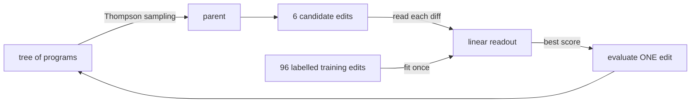
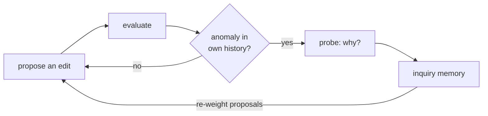
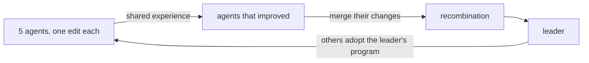
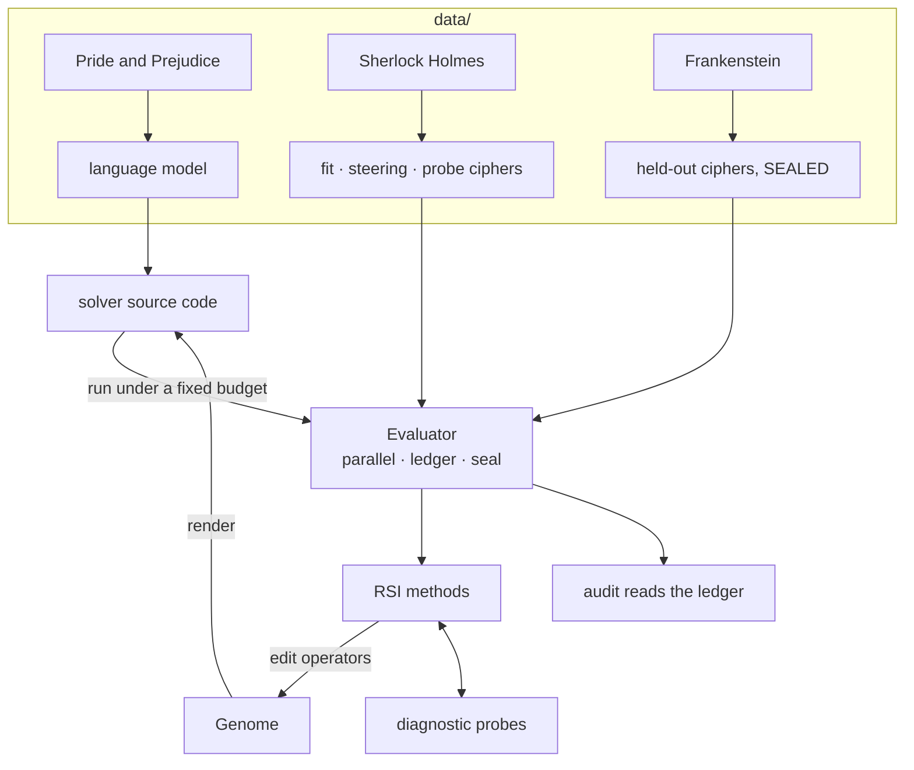

# RSI Research Studio · Assignment 5

**CipherSmith: a self-improving cipher breaker, improved by three October 2026 recursive-self-improvement methods.**

nitishsjsucs · SJSU · November 2026 ·
Reference course: [dlmastery/simple-coding-harness](https://github.com/dlmastery/simple-coding-harness), theme 10
(*Read and rebuild October 2026 research*)

---

## At a glance

- **The problem.** A program that breaks substitution ciphers on real English text.
- **The three methods.** Budget RSI, SO-RSI and SwarmRSI, rebuilt from their mechanisms and run against each other.
  AReaL-RSI, RSIFlow, Self-HPO and RSIGym are built on the same engine.
- **The labs.** All 17 codelabs of section 10 of the
  [course map](https://github.com/dlmastery/simple-coding-harness/blob/main/COURSE-MAP.md#theme-10), plus a finale.
- **Fair by construction.** Matched compute for every comparison, a sealed held-out split, and an automatic audit.

## Headline result

<p align="center">
  
</p>

Every method starts from a program that solves **0%** of unseen ciphers. Each gets 1,920 evaluation runs, 3 seeds.

| Method | Held-out solve rate | What it changes about improvement |
|---|---|---|
| Plain first-order loop (reference) | **0.554 ± 0.090** | nothing: try an edit, keep it if it helps |
| SO-RSI | 0.476 ± 0.120 | asks *why* edits fail before choosing the next one |
| Budget RSI | 0.410 ± 0.127 | scores edits from their code diff before running them |
| SwarmRSI | 0.288 ± 0.174 | five agents with different research directions |

What this shows:

- **Each mechanism works as its paper describes, relative to its own ablation.** Budget RSI's diff-reading roughly doubles
  the held-out score over random selection (0.410 vs 0.215). SO-RSI's probes pick the better edit in 3 of 3 checks.
  The swarm wins when sequential rounds, not compute, are the limit.
- **At matched compute, none of the three beats the plain loop on unseen text** in this domain.
  The [finale](labs/06_finale/three_methods_showdown/README.md) explains why.
- **Six bugs were found and fixed on the way**, each from reading a trace. See [What went wrong](#what-went-wrong).

### Verified

| Check | Result |
|---|---|
| All 18 labs (`run_all.py`) | run end to end: 47 min full, about 4 min with `--quick` |
| Unit tests (`run_tests.py`) | 35 pass |
| Finale audit | passes all four fairness rules |
| Numbers in this README | copied from the committed `output.txt` files |

---

## Contents

1. [The problem](#the-problem)
2. [Three objects of RSI](#three-objects-of-rsi)
3. [The three methods](#the-three-methods)
4. [The 17 codelabs](#the-17-codelabs)
5. [Quick start](#quick-start)
6. [Architecture](#architecture)
7. [Results](#results)
8. [What we can and cannot claim](#what-we-can-and-cannot-claim)
9. [What went wrong](#what-went-wrong)
10. [Fairness rules](#fairness-rules)
11. [Testing](#testing)
12. [Videos](#videos)
13. [Repository layout](#repository-layout)
14. [Limitations](#limitations)
15. [Credits](#credits)

---

## The problem

A **substitution cipher** replaces every letter with another letter (`the` → `fgz`). Breaking one means finding,
among 26! ≈ 4 × 10²⁶ possible keys, the one that turns the ciphertext back into English.

A **solver program** does this with two parts:

- an **objective**: how English-like does a decryption look? (letter n-gram statistics, optionally a dictionary)
- a **search**: start somewhere, swap letters, keep swaps that score better.

The baseline program fails; an improved one succeeds:

```text
$ T="the detective looked at the strange marks on the door and said that the thief had come in through the window before the rain began"

$ python3 -m cipherlab.cli solve --genome '{}' --text "$T"
  decrypt: hat rthtchopt veentr sh hat dhisfmt ysind ef hat reei sfr dsor hash hat haotl ...
  acc    : 0.019          # baseline: 2-gram objective, random start, 1 × 1,000 swaps

$ python3 -m cipherlab.cli solve --genome '{"ngram":4,"word_weight":2.0,"init":"frequency","search":"anneal","temp0":10.0,"iters":5000,"restarts":4}' --text "$T"
  decrypt: the detective looked at the strange marks on the door and said that the thief had come in ...
  acc    : 1.0            # 4-gram + dictionary, frequency start, simulated annealing
```

*(The CLI prints one JSON object; it is shown here one field per line, with long lines cut.)*

### Why a cipher breaker is a good RSI testbed

| Property | Why it matters |
|---|---|
| **The improved object is a real program.** A [`Genome`](cipherlab/program.py#L30) renders to Python source; every edit is a source diff. | Budget RSI scores diffs, SO-RSI diagnoses programs, SwarmRSI recombines program parts. |
| **Evaluation is exact and cheap.** A cipher counts as solved at ≥ 90% correct letters; 48 ciphers take 0.1–3 s. | Hundreds of candidate programs per lab, on a laptop, with seeds. |
| **There is a long ladder.** The baseline solves 0%; good programs reach about 60–70%. | Room to improve, and a ceiling to reason about. |
| **Failures have observable causes.** The harness records whether a program's own objective prefers a wrong key over the true one. | SO-RSI's probes need to know *why*, not just *how much*. |
| **The held-out data is genuinely unseen.** Three different books: see the table below. | "Unseen text" means a different author, era and vocabulary. |

| Book (public domain) | Role |
|---|---|
| *Pride and Prejudice* | trains the language model; never encrypted |
| *The Adventures of Sherlock Holmes* | training, steering and probe ciphers (disjoint regions) |
| *Frankenstein* | the sealed held-out ciphers |

---

## Three objects of RSI

Course theme 09 separates three objects. This repo keeps them in separate code.

| Object | In this repo |
|---|---|
| **Task model**: the thing that does the task | a solver program, rendered by [`program.py`](cipherlab/program.py) and run by [`runtime.py`](cipherlab/runtime.py) under a fixed budget of 20,000 candidate keys per cipher |
| **Research loop**: proposes edits, keeps or discards them | propose an edit → [score it](cipherlab/loop.py#L65) on the steering split → keep it if it [beats](cipherlab/loop.py#L43) the parent |
| **Improver**: the rules that govern the research loop | the methods in [`cipherlab/methods/`](cipherlab/methods); several of them revise themselves while running |

---

## The three methods

The assignment asks for three state-of-the-art RSI methods. These are the three October 2026 methods that section 10
of the course is built around, so every lab maps one-to-one onto the course map. They are close relatives of the
suggested examples: Budget RSI's tree search belongs to the AIDE family; SwarmRSI and AReaL-RSI are multi-agent
scientist systems like AI-Scientist.

### 1 · Budget RSI: score code edits before they run

*arXiv:2610.29121 · code: [`methods/budget_rsi.py`](cipherlab/methods/budget_rsi.py) ·
labs: [10.03](labs/01_budget_rsi_scoring/10_03_run_budget_rsi/README.md),
[10.04](labs/01_budget_rsi_scoring/10_04_analyze_scoring/README.md),
[10.05](labs/01_budget_rsi_scoring/10_05_extend_readout/README.md)*



- **The problem it solves:** evaluating an edit is the expensive step.
- **How:** a linear model, trained once, reads each candidate's unified diff (lines added, functions added, constants
  changed …) and only the best-scored candidate is actually run.
- **Where to branch:** a Huxley–Gödel Machine tree picks the parent by Thompson sampling on the solve counts of each
  program and all its descendants.

### 2 · SO-RSI: ask why before patching

*arXiv:2610.05701 · code: [`methods/so_rsi.py`](cipherlab/methods/so_rsi.py), [`probes.py`](cipherlab/probes.py) ·
labs: [10.06](labs/02_second_order_diagnostics/10_06_run_so_rsi/README.md),
[10.07](labs/02_second_order_diagnostics/10_07_analyze_probes/README.md),
[10.08](labs/02_second_order_diagnostics/10_08_apply_to_debugging/README.md)*



- **The problem it solves:** a first-order loop patches symptoms ("score is low, so search harder") and thrashes.
- **How:** the same loop watches its own history for three anomalies (the same fix failing again, a fix and its
  opposite alternating, an expected gain that never came). When one fires, it buys a diagnostic probe from the same budget.
- **The key probe:** compare how the program scores the key it found against how it scores the *true* key. If it
  prefers the wrong answer, more search cannot help; the objective must change.
- **Memory:** findings re-weight future proposals toward edits that address the diagnosed cause.

### 3 · SwarmRSI: an evolving swarm of research agents

*arXiv:2610.20431 · code: [`methods/swarm_rsi.py`](cipherlab/methods/swarm_rsi.py) ·
labs: [10.09](labs/03_scaling_coordination/10_09_compare_scaling/README.md),
[10.11](labs/03_scaling_coordination/10_11_swarm_rsi/README.md)*



- **Five agents**, each with its own research direction (objective, search, diversify, efficiency, explore) and a
  written hypothesis.
- **Each generation:** every agent tries one edit, weighted by what has worked for anyone recently.
- **Recombination:** improvements that different agents found on different parts of the program are merged.
- **The recursive part:** each agent's own proposal weights are revised by what worked for it.

### The other four mechanisms

| Mechanism | Paper | What it adds | Lab |
|---|---|---|---|
| AReaL-RSI | arXiv:2610.18083 | a leader, two researchers, and a memory that shares only replicated findings | [10.10](labs/03_scaling_coordination/10_10_areal_leader_follower/README.md) |
| RSIFlow | arXiv:2610.21791 | a meta-agent that rewires the improvement workflow when it stalls | [10.13](labs/04_adaptive_workflows/10_13_rsiflow_meta_agent/README.md) |
| Self-HPO | arXiv:2610.22791 | alternates between improving the program's scaffold and its weights | [10.14](labs/04_adaptive_workflows/10_14_self_hpo/README.md) |
| RSIGym | arXiv:2610.10310 | permissioned services, improvement tracks, and the RSI-Index | [10.15](labs/05_environments_metrics/10_15_rsi_index/README.md) |

---

## The 17 codelabs

Each lab has one script (`lab.py`), a README with a code walkthrough linked to exact lines, the real output of a full
run (`output.txt`, also shown in the README) and a quiz. `--quick` runs any lab in under a minute.

| Lab | The question it answers |
|---|---|
| **Group 00 · Read a frontier claim** | |
| [10.01 Claim vs evidence](labs/00_reading_frontier_research/10_01_claim_vs_evidence/README.md) | Does the best score after selection survive re-measurement? |
| [10.02 Audit a paper](labs/00_reading_frontier_research/10_02_audit_paper/README.md) | What did an experiment measure, and can a ledger prove it? |
| **Group 01 · Budget RSI** | |
| [10.03 Run Budget RSI](labs/01_budget_rsi_scoring/10_03_run_budget_rsi/README.md) | Does scoring edits before running them buy better programs? |
| [10.04 Analyse the scoring](labs/01_budget_rsi_scoring/10_04_analyze_scoring/README.md) | Which diff features predict a better program, and what can a diff not see? |
| [10.05 Extend the readout](labs/01_budget_rsi_scoring/10_05_extend_readout/README.md) | Do signed features help? Does it transfer? How much does training data matter? |
| **Group 02 · Second-order RSI** | |
| [10.06 Run SO-RSI](labs/02_second_order_diagnostics/10_06_run_so_rsi/README.md) | Does asking *why* beat patching symptoms, at the same cost? |
| [10.07 Analyse the probes](labs/02_second_order_diagnostics/10_07_analyze_probes/README.md) | When does each anomaly fire, and do the probes pick the right edit? |
| [10.08 Apply to debugging](labs/02_second_order_diagnostics/10_08_apply_to_debugging/README.md) | Is the function wrong, or is the test? |
| **Group 03 · Scaling RSI** | |
| [10.09 Compare scaling](labs/03_scaling_coordination/10_09_compare_scaling/README.md) | How do a leader-led team and a peer swarm spend one budget? |
| [10.10 Leader-follower](labs/03_scaling_coordination/10_10_areal_leader_follower/README.md) | Share only replicated findings, everything, or nothing? |
| [10.11 Swarm evolution](labs/03_scaling_coordination/10_11_swarm_rsi/README.md) | What do mutation, recombination and sharing each add? |
| **Group 04 · Adaptive workflows** | |
| [10.12 Compare workflows](labs/04_adaptive_workflows/10_12_compare_workflows/README.md) | Which object does each method adapt, and on what signal? |
| [10.13 RSIFlow meta-agent](labs/04_adaptive_workflows/10_13_rsiflow_meta_agent/README.md) | Does a self-rewiring workflow beat a fixed one? |
| [10.14 Self-HPO](labs/04_adaptive_workflows/10_14_self_hpo/README.md) | Is improving scaffold and weights together worth more than the sum? |
| **Group 05 · Environments and metrics** | |
| [10.15 RSI-Index](labs/05_environments_metrics/10_15_rsi_index/README.md) | What share of the remaining gap does each track close? |
| [10.16 Environments](labs/05_environments_metrics/10_16_environments/README.md) | In-process services vs terminal vs self-play: cost and capability |
| [10.17 Metrics](labs/05_environments_metrics/10_17_metrics/README.md) | What does each new metric say about our runs, and what does it hide? |
| **Finale** | |
| [Three methods, one budget](labs/06_finale/three_methods_showdown/README.md) | Which procedure builds the best breaker for unseen text? |

---

## Quick start

Python 3.9+ with NumPy and Matplotlib. No API keys, no GPU, no network.

```bash
git clone https://github.com/nitishsjsucs/rsi-research-studio-assignment-5.git
cd rsi-research-studio-assignment-5
python3 -m pip install numpy matplotlib      # if you don't have them

python3 run_tests.py                         # 35 unit tests, about 1 s
python3 labs/02_second_order_diagnostics/10_06_run_so_rsi/lab.py --quick   # one lab, under a minute
python3 run_all.py --quick                   # all 18 labs with small budgets, about 4 min
python3 run_all.py                           # the full runs whose outputs are committed, about 47 min
```

The harness is also a command-line tool ([`cli.py`](cipherlab/cli.py)):

| Command | What it does |
|---|---|
| `python3 -m cipherlab.cli render --genome '{...}'` | prints a program's Python source |
| `python3 -m cipherlab.cli solve --genome '{...}' --text "..."` | encrypts your sentence and breaks it |
| `python3 -m cipherlab.cli evaluate --genome '{...}' --split steering` | scores a program on a split (held-out refuses unless `--unseal`) |

---

## Architecture



| Module | Lines | Role |
|---|---:|---|
| [`corpus.py`](cipherlab/corpus.py) | 88 | the language model: letter n-grams and a 3,000-word dictionary, from one book |
| [`tasks.py`](cipherlab/tasks.py) | 129 | cipher instances and the four splits |
| [`program.py`](cipherlab/program.py) | 254 | `Genome` → Python source; features read from a unified diff |
| [`runtime.py`](cipherlab/runtime.py) | 122 | the fixed harness: budget cap, crash-tolerant runs, true-key fitness for probes |
| [`evaluate.py`](cipherlab/evaluate.py) | 121 | parallel evaluation, per-split ledger, sealed held-out |
| [`edits.py`](cipherlab/edits.py) | 135 | 24 edit operators, each with an inverse and a prior expected gain |
| [`probes.py`](cipherlab/probes.py) | 128 | diagnostic probes → causes → remedies |
| [`loop.py`](cipherlab/loop.py) | 155 | scores, budgets, histories, result files |
| [`audit.py`](cipherlab/audit.py) | 37 | the four fairness rules, read from the ledger |
| [`methods/`](cipherlab/methods) | 1,186 | the seven mechanisms |

---

## Results

Full runs, 3 seeds, 1,920 steering runs per arm unless noted. Each lab README has the full table and its interpretation.

| Lab | Finding |
|---|---|
| [10.01](labs/00_reading_frontier_research/10_01_claim_vs_evidence/README.md) | The best of 16 edits "gains" **+0.167** on the split used to pick it, but only **+0.010** when re-measured. |
| [10.02](labs/00_reading_frontier_research/10_02_audit_paper/README.md) | The ledger catches a held-out peek, a doubled budget and a single seed. |
| [10.03](labs/01_budget_rsi_scoring/10_03_run_budget_rsi/README.md) | Budget RSI **0.410** held-out vs **0.215** with random selection, and 0.247 for evaluating all 6 candidates. |
| [10.04](labs/01_budget_rsi_scoring/10_04_analyze_scoring/README.md) | Lines added is the strongest signal; "search more" and "search less" have **identical** diff features. |
| [10.05](labs/01_budget_rsi_scoring/10_05_extend_readout/README.md) | Signed features reach **0.453**. Trained on shallow programs, the same readout falls to **0.099**. |
| [10.06](labs/02_second_order_diagnostics/10_06_run_so_rsi/README.md) | SO-RSI **thrashes less** (10.7 vs 14.7 anomalies) but scores lower held-out (**0.476** vs 0.554). |
| [10.07](labs/02_second_order_diagnostics/10_07_analyze_probes/README.md) | A weak program's own objective prefers a wrong decryption; probes pick the better edit **3 / 3**. |
| [10.08](labs/02_second_order_diagnostics/10_08_apply_to_debugging/README.md) | All three anomalies fire on a real debugging log; a probe shows the *test* was wrong. |
| [10.10](labs/03_scaling_coordination/10_10_areal_leader_follower/README.md) | Sharing findings (0.205) does **not** beat independent researchers (0.293) at this budget. |
| [10.11](labs/03_scaling_coordination/10_11_swarm_rsi/README.md) | Swarm vs one agent: **0.288 vs 0.554** at equal compute, **0.288 vs 0.212** at equal rounds. |
| [10.13](labs/04_adaptive_workflows/10_13_rsiflow_meta_agent/README.md) | The self-rewiring workflow scores **0.575** vs 0.554 fixed; it switched one of its own rules off. |
| [10.14](labs/04_adaptive_workflows/10_14_self_hpo/README.md) | The scaffold carries the gain (0.474 vs 0.208 for weights); **no synergy** when combined. |
| [10.15](labs/05_environments_metrics/10_15_rsi_index/README.md) | RSI-Index: joint **0.262** > data 0.006 + harness 0.132; the course's printed formula has a sign error. |
| [10.16](labs/05_environments_metrics/10_16_environments/README.md) | Terminal and in-process give the same program; the terminal takes **2×** the time. |
| [Finale](labs/06_finale/three_methods_showdown/README.md) | Held-out: plain loop **0.554**, SO-RSI 0.476, Budget RSI 0.410, SwarmRSI 0.288. |

## What we can and cannot claim

**Supported by these runs:**

- Each mechanism beats its own ablation where the ablation isolates it.
- Probe recommendations pick the better of two edits (3 / 3), and the objective probe exposes failures search cannot fix.
- Selection inflates headline numbers (lab 10.01): a selected gain must be re-measured.

**Not supported, or not tested:**

- That any of the three methods beats a well-chosen first-order loop at equal compute. Here, none does.
- Anything about LLM proposers, other domains or larger budgets. Our proposer chooses among 24 edit operators.
- The papers' headline numbers. A laptop adaptation preserves mechanisms, not scale.
- Differences smaller than about 0.1. Standard deviations across seeds are 0.09–0.17.

---

## What went wrong

Six problems surfaced while building this, each found by reading one run's history rather than an average score.
Each fix is in the code with a comment. Where a full run existed before the fix, its output is committed beside the new one.

**1. Nothing ever improved from the baseline.**
- *Cause:* the baseline solves 0 of 48 ciphers, and so does nearly every early edit, so "solved count" gave no signal.
- *Fix:* compare solved count first, and use mean letter accuracy to break ties ([`Scored.key`](cipherlab/loop.py#L39)).

**2. SO-RSI blocked "search longer" exactly when it was the right fix.**
- *Cause:* one probe signal mixed up a program stopping early by its own choice with the harness cutting it off.
  They need opposite remedies.
- *Fix:* two separate diagnoses, *undersearched* and *cap-bound* ([`probes.py`](cipherlab/probes.py#L102)), with a test.

**3. Budget RSI lost to its own ablation (0.099 vs 0.215).**
- *Cause:* its readout was trained on edits to shallow, weak programs, where adding a function rarely helps, so it
  steered every search away from the dictionary.
- *Fix:* train on programs up to 8 edits deep, matching how far the search goes. The failure is kept as a measured
  experiment in [lab 10.05](labs/01_budget_rsi_scoring/10_05_extend_readout/README.md), part C.

**4. One SO-RSI run sat at 0.458 for 25 rounds.**
- *Cause:* a finding whose problem had already been fixed kept steering, and kept blocking the edit the newest probe recommended.
- *Fix:* only open findings steer ([`InquiryMemory.weights`](cipherlab/methods/so_rsi.py#L99)), with a regression test.
- *Outcome:* the stall is gone (0.458 → 0.521), but the held-out average did not change (0.479 → 0.476). A real bug,
  and not the reason SO-RSI trails the plain loop.
  [Before](labs/02_second_order_diagnostics/10_06_run_so_rsi/output_before_memory_fix.txt) ·
  [after](labs/02_second_order_diagnostics/10_06_run_so_rsi/output.txt)

**5. AReaL's leader retired useful edits from the team.**
- *Cause:* every edit a losing campaign tried was counted as a failure, even edits that had worked inside it.
- *Fix:* credit each edit by its own outcome ([`Leader.review`](cipherlab/methods/areal.py#L80)), with a regression test.
  [Before](labs/03_scaling_coordination/10_10_areal_leader_follower/output_before_credit_fix.txt)

**6. After fix 5, the AReaL lab ran for 25 minutes instead of 3.**
- *Cause:* AReaL re-evaluated programs it had already seen for free, so a stuck team never used up its budget.
- *Fix:* charge for re-evaluations like every other method, and cap campaigns at 200.
  [After](labs/03_scaling_coordination/10_10_areal_leader_follower/output.txt)

**The lesson:** none of these showed up in an average; each was visible in a single run's history. And fix 4 is a
reminder that a real bug is not necessarily *the* reason for a result.

---

## Fairness rules

Every comparison follows these rules; lab 10.02 and the finale check them automatically.

1. **One currency.** Cost is counted in *instance-runs* (one program, one cipher, one seed). Compared arms get the same
   budget, and probes, replications and recombinations are paid from it. Re-running an edit costs again.
2. **Four splits, four roles.**

   | Split | Size | Used for |
   |---|---:|---|
   | fit | 16 | labelling Budget RSI's training edits |
   | steering | 48 | every keep/discard decision |
   | probe | 24 | diagnostics only |
   | held-out | 96 | the final report only (a different book) |

3. **Sealed held-out.** The evaluator refuses the held-out split until every search has finished, and its ledger
   records every access with a caller and a timestamp.
4. **Seeds.** 3 search seeds per comparison, reported as mean ± standard deviation.
5. **Same proposer.** When a method adds machinery (SO-RSI, RSIFlow), its baseline uses the identical proposer and
   acceptance rule, so the only difference is the machinery.

---

## Testing

```bash
python3 run_tests.py      # 35 tests, about 1 s
```

The tests in [`tests/`](tests) check:

- **Data and splits:** the language model is a probability distribution; splits are disjoint and deterministic.
- **Programs:** random programs compile; edits produce the expected diff shapes; every edit has an inverse that round-trips.
- **The harness:** it enforces its budget cap, records crashes as data, and keeps held-out sealed.
- **The mechanisms:** each anomaly detector fires on its pattern and stays quiet otherwise; probes tell an objective
  problem from a search problem; the readout recovers a known linear rule; the tree prefers a productive branch;
  recombination takes exactly one module.
- **Metrics and audit:** the RSI-Index reproduces the course example (and its sign error); the auditor flags an early
  held-out access and a budget mismatch.
- **Regressions:** bugs 4 and 5 above stay fixed.

---

## Videos

One recording per part, following [docs/VIDEO_SCRIPT.md](docs/VIDEO_SCRIPT.md) (what to open, run and point at).

| Part | Topic | YouTube |
|---|---|---|
| 0 | The problem, the harness, the fairness rules | *link to be added* |
| 1 | Read a frontier claim (10.01–10.02) | *link to be added* |
| 2 | Budget RSI (10.03–10.05) | *link to be added* |
| 3 | SO-RSI (10.06–10.08) | *link to be added* |
| 4 | Scaling: AReaL-RSI and SwarmRSI (10.09–10.11) | *link to be added* |
| 5 | Adaptive workflows: RSIFlow and Self-HPO (10.12–10.14) | *link to be added* |
| 6 | Environments and metrics (10.15–10.17) | *link to be added* |
| 7 | Finale: three methods, one budget | *link to be added* |

---

## Repository layout

```text
rsi-research-studio-assignment-5/
├── cipherlab/               the engine: task, program, harness, evaluator, probes, audit, CLI
│   └── methods/             budget_rsi, so_rsi, swarm_rsi, areal, rsiflow, self_hpo, rsigym
├── labs/
│   ├── 00_reading_frontier_research/   10.01–10.02
│   ├── 01_budget_rsi_scoring/          10.03–10.05
│   ├── 02_second_order_diagnostics/    10.06–10.08
│   ├── 03_scaling_coordination/        10.09–10.11
│   ├── 04_adaptive_workflows/          10.12–10.14
│   ├── 05_environments_metrics/        10.15–10.17
│   └── 06_finale/                      three methods, one budget
├── data/                    three public-domain books (see data/NOTICE.md)
├── results/                 JSON written by the labs
├── docs/                    figures/ and VIDEO_SCRIPT.md
├── tests/
├── run_tests.py
└── run_all.py
```

---

## Limitations

- **The proposer is not an LLM.** Edits come from a policy over 24 operators. The papers use LLM agents that write
  arbitrary patches, so our edit space is smaller and cleaner than theirs.
- **One task, small budgets.** Ciphers only, 1,920 runs per arm, 3 seeds. Small differences are within seed noise,
  and the lab READMEs say so where it applies.
- **Hand-written probes and rules.** SO-RSI's probes, RSIFlow's rules and the swarm's directions encode domain
  knowledge written by hand; the papers learn or generate more of this.
- **Mechanisms, not headlines.** None of the papers' reported numbers are reproduced or expected to be; see the audits
  in [lab 10.02](labs/00_reading_frontier_research/10_02_audit_paper/README.md).
- **Paper details come from the course's summaries**
  ([PAPER_SUMMARIES.md](https://github.com/dlmastery/simple-coding-harness/blob/main/12_october_2026_papers/PAPER_SUMMARIES.md)),
  not from re-reading every paper end to end.

---

## Credits

- **Course and lab structure:** [dlmastery/simple-coding-harness](https://github.com/dlmastery/simple-coding-harness),
  theme 10 and its October 2026 paper summaries.
- **Papers:** Budget RSI (arXiv:2610.29121), SO-RSI (2610.05701), SwarmRSI (2610.20431), AReaL-RSI (2610.18083),
  RSIFlow (2610.21791), Self-HPO (2610.22791), RSIGym (2610.10310), Terminal-RSI (2610.22192), R2Orch (2610.22740).
- **Texts:** Project Gutenberg (public domain).
- Built with AI coding assistance (Claude); every number in this README comes from the committed outputs.

MIT License.
