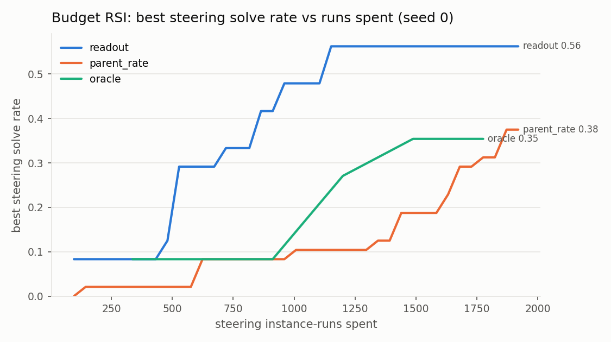

# 10.03 · Run Budget RSI

**Group 01 · Budget RSI: scoring before running** (arXiv:2610.29121) · Previous: [10.02](../../00_reading_frontier_research/10_02_audit_paper/README.md) · Next: [10.04](../10_04_analyze_scoring/README.md)

> **Question.** Does scoring edits *before* running them buy better programs per evaluation?

## The mechanism, and our adaptation

| | Paper | This repo |
|---|---|---|
| Object being edited | a GPT-4o coding-agent scaffold | a cipher-breaker program, [rendered to real Python](../../../cipherlab/program.py#L83) |
| Readout | linear, on parent steering rate + 8 diff coordinates | [`LinearReadout`](../../../cipherlab/methods/budget_rsi.py#L39) (ridge, standardised) on `parent_score` + [8 coordinates read from the unified diff](../../../cipherlab/program.py#L209) |
| Training data | 96 scaffold edits × 4 evaluations of a 16-instance fit split | [`scaffold_edits()`](../../../cipherlab/methods/budget_rsi.py#L90): 96 random edits of random programs, each parent and child run on 16 fit ciphers × 4 seeds |
| Search | Huxley-Gödel Machine: Thompson sampling on clade counts | [`HGMTree.select_parent`](../../../cipherlab/methods/budget_rsi.py#L160): `Beta(1+S, 1+F)` over the pooled counts of a node and all its descendants |
| Selection | readout picks one edit to evaluate | [`run()`](../../../cipherlab/methods/budget_rsi.py#L176): 6 proposals, readout picks 1, only that one runs on 48 steering ciphers |
| Held-out | rest of HumanEval+ | 96 Frankenstein ciphers, [sealed](../../../cipherlab/evaluate.py#L94) until the report |

One deliberate difference: our label is the child's **mean letter accuracy** on the fit split, not its solve
rate, because random scaffold programs mostly solve nothing on 16 ciphers (the output prints how few
solve-rate labels are non-zero).

## Code walkthrough

1. **Training set** — `scaffold_edits()` draws a parent by a random walk from the baseline
   ([`random_genome`](../../../cipherlab/edits.py#L128)), picks an applicable edit, and builds the row with
   [`edit_row()`](../../../cipherlab/methods/budget_rsi.py#L72): `[parent_score] + diff_features + signed_features`.
   The paper readout uses the first 9 columns; lab 10.05 uses all 16. The set is cached in `results/` so every lab trains on the same 96 edits.
2. **Readout** — `fit()` standardises each column (a column that never varies is zeroed instead of exploding)
   and solves the ridge normal equations; `predict()` is one matrix-vector product.
3. **Tree search** — each expansion: Thompson-sample a parent, list its applicable edits, keep 6 at random,
   then branch on `selector` ([line 196](../../../cipherlab/methods/budget_rsi.py#L196)): the readout's argmax;
   one at random (the parent-rate ablation: every sibling has the same parent rate, so the readout would be constant);
   or all 6 (the oracle, which pays 6× per expansion — [line 185](../../../cipherlab/methods/budget_rsi.py#L185)).
4. **Report** — the lab unseals held-out once and scores each arm's best program on 96 ciphers × 2 seeds.

## Run it

```bash
python3 labs/01_budget_rsi_scoring/10_03_run_budget_rsi/lab.py           # 3 seeds × 3 selectors, ~8-12 min
python3 labs/01_budget_rsi_scoring/10_03_run_budget_rsi/lab.py --quick   # 1 seed, 12 expansions
```

## Output (full run)

<!-- output lines=60 -->
```text
$ python3 labs/01_budget_rsi_scoring/10_03_run_budget_rsi/lab.py
==============================================================================
Lab 10.03 · Run Budget RSI
Question: Does scoring edits before running them buy better programs per evaluation?
==============================================================================

--- 1. Training data for the readout (96 scaffold edits) --------------------
  96 labelled edits, 9536 fit-split instance-runs (one-time cost)
  label = child mean letter accuracy on fit x 4 seeds: mean 0.213, range 0.045-0.407; solve-rate labels > 0 for only 38%
  readout fit on 9 features: parent_score, lines_added, lines_deleted, hunks, defs_added, defs_removed, imports_changed, constants_changed, control_flow_changed

--- 2. Tree search at 1920 steering runs per arm (3 seeds) ------------------
  seed 0 readout      expansions=39 best steering=0.562  2-gram words×1 freq hill polish k=1 8x2000
  seed 0 parent_rate  expansions=39 best steering=0.375  3-gram words×2 rand anneal T2 polish k=0.1 2x2000
  seed 0 oracle       expansions= 6 best steering=0.354  2-gram words×2 rand hill polish 4x1000
  seed 1 readout      expansions=39 best steering=0.479  2-gram words×2 freq hill polish 8x2000
  seed 1 parent_rate  expansions=39 best steering=0.271  3-gram words×2 freq anneal T2 k=0.001 vocab=1000 1x4000
  seed 1 oracle       expansions= 6 best steering=0.312  3-gram words×2 freq hill polish 2x1000
  seed 2 readout      expansions=39 best steering=0.354  2-gram words×2 freq hill polish k=0.1 vocab=1000 2x250
  seed 2 parent_rate  expansions=39 best steering=0.208  3-gram rand hill k=0.1 2x4000
  seed 2 oracle       expansions= 6 best steering=0.146  2-gram words×2 rand anneal T2 2x2000

  one expansion, shown in full (readout arm, seed 0, first 8):
    parent #0  (0.000)  --    add_polish-->  0.083
    parent #1  (0.083)  --  smoothing_up-->  0.062
    parent #1  (0.083)  --    iters_down-->  0.042
    parent #2  (0.062)  --init_frequency-->  0.062
    parent #1  (0.083)  --init_frequency-->  0.042
    parent #4  (0.062)  --  smoothing_up-->  0.042
    parent #1  (0.083)  --  smoothing_up-->  0.062
    parent #6  (0.042)  --   restarts_up-->  0.042

--- 3. Held-out report (unsealed once, here) --------------------------------
  selector     expansions  steering best  held-out       runs
  -----------  ----------  -------------  -------------  ----
  readout      39          0.465 ± 0.105  0.410 ± 0.127  1920
  parent_rate  39          0.285 ± 0.084  0.215 ± 0.081  1920
  oracle       6           0.271 ± 0.110  0.247 ± 0.077  1776

--- 4. Cost of an expansion -------------------------------------------------
  evaluate all 6 proposals: 288 runs per expansion
  readout: rank 6 in microseconds, evaluate 1: 48 runs per expansion (83% less)
  one-time readout training: 9536 fit runs, amortised over every expansion of every run

done in 203s
```
<!-- /output -->



## What the numbers say

| Selector | Expansions | Best steering | Held-out (96 Frankenstein ciphers × 2 seeds) |
|---|---:|---|---|
| **readout** (the method) | 39 | 0.465 ± 0.105 | **0.410 ± 0.127** |
| parent-rate ablation | 39 | 0.285 ± 0.084 | 0.215 ± 0.081 |
| oracle (evaluate all 6) | 6 | 0.271 ± 0.110 | 0.247 ± 0.077 |

- **Reading the diff roughly doubles the held-out result at the same cost.** The only difference from the ablation
  is the choice among 6 siblings; the readout's picks lead every seed's tree toward the dictionary term, a better
  initial key and polishing (all three best programs have `words`, `freq` or `polish`).
- **Perfect information is not worth 6× the price.** The oracle always keeps the best of 6, but at 288 runs per
  expansion it gets 6 expansions instead of 39 and ends below the readout.
- **Steering overstates held-out by 0.02-0.07** for every selector: selection inflation (lab 10.01) plus a different author.
- Same direction as the paper (87.0% vs 84.2% for the ablation on HumanEval+); different scale, task and model.

## Quiz

1. *What is the steering split for?* Selection. It lets the search compare candidates without touching held-out, so held-out stays an honest final measurement.
2. *Why is the oracle worse at the same budget?* It pays 6 evaluations per expansion, so it expands a sixth as often; a good-enough ranking at 1/6 of the cost buys more search depth.
3. *What does the parent-rate ablation isolate?* The value of reading the diff. Parent selection (HGM) is identical; only the choice among siblings differs.
