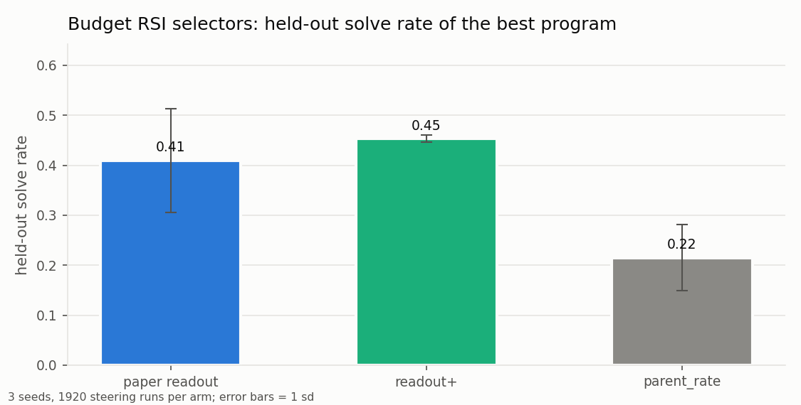

# 10.05 · Extend the readout to your own edits

**Group 01 · Budget RSI** · Previous: [10.04](../10_04_analyze_scoring/README.md) · Next: [10.06 Run SO-RSI](../../02_second_order_diagnostics/10_06_run_so_rsi/README.md)

> **Question.** Do signed coordinates fix the blind spot found in 10.04, does the readout transfer to a new kind of edit, and how much does its training distribution matter?

## Two extensions, both still "score before running"

**A. Readout+.** [`signed_features()`](../../../cipherlab/program.py#L233) reads seven more coordinates from
the *same* diff text: for each tunable constant (`NGRAM_ORDER`, `ITERATIONS`, `RESTARTS`, `WORD_WEIGHT`,
`START_TEMPERATURE`, `SMOOTHING`, `VOCAB`), `log2(new/old)`; a constant that appears counts +1, one that
disappears −1. Nothing is executed. The lab compares, at one budget and over 3 seeds: the paper readout
(9 features), readout+ (16), and the parent-rate ablation. Held-out is reported at the end.

**B. Compound edits.** An LLM patch often changes two things at once. `compound_edits()` in [lab.py](lab.py)
builds 24 two-operator edits (each labelled exactly like the training edits, fit split × 4 seeds), and asks
whether readouts trained only on *single* edits still rank them: correlation of predicted vs actual gain,
and the mean gain of each readout's top quarter vs all.

**C. The training distribution.** The first full run of this repo trained the readout on parents from random
walks of at most **5** edits from the baseline. On such weak parents, edits that add a function rarely pay off
within 16 ciphers; that readout weighted `defs_added` at −0.023 (the deep-walk readout: −0.009), steered every
tree away from the dictionary term, and lost to the parent-rate ablation. Parents from walks of up to **8**
edits match how far the search actually travels, and that is now the default
([`scaffold_edits`](../../../cipherlab/methods/budget_rsi.py#L90)). Part C keeps the failure as a measured
ablation: same search, same seeds, readout trained on shallow walks.

## What the numbers say

| Selector (3 seeds, 1,920 steering runs each) | Held-out solve rate |
|---|---|
| readout+ (paper's 9 features + 7 signed) | **0.453 ± 0.009** |
| paper readout (9 features) | 0.410 ± 0.127 |
| parent-rate ablation | 0.215 ± 0.081 |
| paper readout, trained on shallow walks | 0.099 ± 0.050 |

- **Signed coordinates help a little and stabilise a lot.** Readout+ reaches the same 0.521 steering score on all
  three seeds; the paper readout ranges 0.354–0.562. The largest signed weight is on `dlog2_restarts` (+0.011):
  more restarts is the edit whose *direction* matters most here.
- **Compound edits do not transfer well.** Both readouts rank the 24 two-operator edits with positive correlation
  (+0.24, +0.30), but the quarter each puts on top has a *below-average* gain. A readout trained on single edits
  has never seen two changes interact.
- **The training distribution decides everything.** Same features, same model, same search: trained on shallow
  parents the readout never adds the dictionary (all three final programs are 2-gram without words) and ends
  *below the ablation*. The paper's 96 edits come from the agent's own scaffold, i.e. from the distribution it
  will rank; ours now do too.

## Run it

```bash
python3 labs/01_budget_rsi_scoring/10_05_extend_readout/lab.py           # ~8-12 min
python3 labs/01_budget_rsi_scoring/10_05_extend_readout/lab.py --quick   # 1 seed, 8 compound edits
```

## Output (full run)

<!-- output lines=60 -->
```text
$ python3 labs/01_budget_rsi_scoring/10_05_extend_readout/lab.py
==============================================================================
Lab 10.05 · Extend the readout
Question: Do signed coordinates fix the blind spot, and does the readout transfer to compound edits?
==============================================================================

--- A1. Readout+ coefficients on the signed coordinates ---------------------
  signed coordinate        coefficient
  -----------------------  -----------
  dlog2_ngram_order        +0.0066    
  dlog2_iterations         +0.0031    
  dlog2_restarts           +0.0110    
  dlog2_word_weight        -0.0038    
  dlog2_start_temperature  -0.0055    
  dlog2_smoothing          +0.0001    
  dlog2_vocab              +0.0010    

--- A2. Tree search with each readout (1920 runs per arm, 3 seeds) ----------
  seed 0 paper readout  best steering=0.562  2-gram words×1 freq hill polish k=1 8x2000
  seed 0 readout+       best steering=0.521  3-gram words×1 freq hill polish 8x2000
  seed 0 parent_rate    best steering=0.375  3-gram words×2 rand anneal T2 polish k=0.1 2x2000
  seed 1 paper readout  best steering=0.479  2-gram words×2 freq hill polish 8x2000
  seed 1 readout+       best steering=0.521  2-gram words×1 freq hill polish k=0.1 vocab=10000 32x2000
  seed 1 parent_rate    best steering=0.271  3-gram words×2 freq anneal T2 k=0.001 vocab=1000 1x4000
  seed 2 paper readout  best steering=0.354  2-gram words×2 freq hill polish k=0.1 vocab=1000 2x250
  seed 2 readout+       best steering=0.521  2-gram words×1 rand hill polish 16x1000
  seed 2 parent_rate    best steering=0.208  3-gram rand hill k=0.1 2x4000
  selector       steering best  held-out     
  -------------  -------------  -------------
  paper readout  0.465 ± 0.105  0.410 ± 0.127
  readout+       0.521 ± 0.000  0.453 ± 0.009
  parent_rate    0.285 ± 0.084  0.215 ± 0.081

--- B. Transfer to 24 compound (two-operator) edits -------------------------
  paper readout  corr(pred gain, gain) = +0.241;  mean gain of its top quarter = -0.0153 vs all = -0.0012
  readout+       corr(pred gain, gain) = +0.296;  mean gain of its top quarter = -0.0084 vs all = -0.0012
  best compound edit in the sample: init_frequency+iters_down (+0.1021)

--- C. Training distribution: parents from shallow walks (<= 5 edits) vs deep (<= 8) 
  coefficient on defs_added: deep-walk readout -0.0093, shallow-walk readout -0.0229
  seed 0 shallow-trained readout best steering=0.188 held-out=0.151  2-gram freq anneal T2 polish k=0.001 1x4000
  seed 1 shallow-trained readout best steering=0.104 held-out=0.052  2-gram rand anneal T4 polish 1x1000
  seed 2 shallow-trained readout best steering=0.146 held-out=0.094  2-gram freq anneal T4 polish k=0.1 1x2000
  selector                    held-out     
  --------------------------  -------------
  paper readout               0.410 ± 0.127
  readout (shallow training)  0.099 ± 0.050
  parent_rate                 0.215 ± 0.081

done in 350s
```
<!-- /output -->



## Quiz

1. *What if success is not correlated with the features?* The readout ranks at chance and Budget RSI degrades to the parent-rate ablation; feature design is the method's real hyper-parameter.
2. *Can Budget RSI work outside code?* Yes, if there is a steering split, features computable from the proposed change without running it, and a correlation between those features and quality.
3. *Is readout+ still "before running"?* Yes: the signed coordinates are parsed from the patch text. It adds domain knowledge (which constants matter), not execution.
