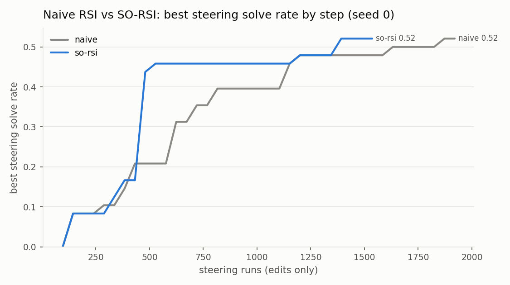

# 10.06 · Run Naive RSI vs SO-RSI

**Group 02 · Second-order RSI: diagnostic inquiry** (arXiv:2610.05701) · Previous: [10.05](../../01_budget_rsi_scoring/10_05_extend_readout/README.md) · Next: [10.07](../10_07_analyze_probes/README.md)

> **Question.** Does asking *why* before patching beat patching the symptom, at the same cost?

## The two arms (one function, one flag)

Both arms are [`so_rsi.run()`](../../../cipherlab/methods/so_rsi.py#L121); `second_order` is the only difference.

| | Naive RSI (first order) | SO-RSI (second order) |
|---|---|---|
| Proposer | samples an edit from [`SYMPTOM_PRIOR`](../../../cipherlab/edits.py#L103): mostly "search harder" (`iters_up`, `restarts_up`, temperature) | the same prior, **re-weighted by the inquiry memory** |
| Acceptance | keep the child if it [beats](../../../cipherlab/loop.py#L43) the parent on 48 steering ciphers | identical |
| Watches its own trace | no | [`AnomalyDetector.check`](../../../cipherlab/methods/so_rsi.py#L49): recurrence (L55), opposing edits (L59), expectation mismatch (L63) |
| On an anomaly | — | buys a [probe](../../../cipherlab/probes.py#L123) (48 runs, charged to the same budget), once per program |
| Memory | — | [`InquiryMemory`](../../../cipherlab/methods/so_rsi.py#L82): boosts edits that address the diagnosed mechanism ×4 (L107), damps edits the evidence calls futile ×0.1, damps an edit that failed twice from this parent ×0.05 |

## Code walkthrough

1. **The loop** ([L121-L163](../../../cipherlab/methods/so_rsi.py#L121)): sample → apply → score → accept if better → record a [`Step`](../../../cipherlab/loop.py#L103) with the edit's prior *expected* gain.
2. **Detection** (`if second_order:`, [L149](../../../cipherlab/methods/so_rsi.py#L149)): after every step the detector reads the last six steps.
3. **Probes** ([`diagnose_rows`](../../../cipherlab/probes.py#L83)) read per-cipher traces the harness records for free:
   `fitness_found` vs `fitness_true` (does the program's own objective prefer a wrong key? [L86](../../../cipherlab/probes.py#L86)),
   where in its budget the program last improved (stalled early vs still improving), whether it hit the harness cap, the
   short/long split, and seed-to-seed flips. Thresholds turn these into mechanisms ([L102-L118](../../../cipherlab/probes.py#L102)).
4. **Remedies** ([`REMEDIES`](../../../cipherlab/probes.py#L39)) map each mechanism to edits that address it and edits it makes futile.
   Two mechanisms look alike and need opposite fixes: *undersearched* (the program stops itself early → search longer)
   and *cap-bound* (the harness truncates → searching longer is wasted). The first version of this repo merged them and
   SO-RSI vetoed the right edit at baseline; splitting them was the fix (see the root README, "What went wrong").
5. **Fairness** — both arms get identical budgets; a repeated edit is charged again ([`Scorer`](../../../cipherlab/loop.py#L65)),
   because a real agent that retries a fix pays for the rerun.

## Run it

```bash
python3 labs/02_second_order_diagnostics/10_06_run_so_rsi/lab.py           # 3 seeds × 2 arms, ~4-6 min
python3 labs/02_second_order_diagnostics/10_06_run_so_rsi/lab.py --quick   # 1 seed, 12 steps
```

## Output (full run): the start of the seed-0 SO-RSI trace

<!-- output from="seed 0 · so-rsi" lines=36 -->
```text
--- seed 0 · so-rsi ---------------------------------------------------------
  r01 restarts_up     0.000 -> 0.000 KEEP
      anomaly ['mismatch'] -> probe: fail=48/48 obj_gap=0.35 stalled=0.44 under=0.46 cap=0.00 var=0.00 [short=0.00 medium=0.00 long=0.00]
      mechanisms=['objective', 'undersearched'] recommend=['ngram_up', 'add_words', 'words_up', 'smoothing_down']
  r02 iters_up        0.000 -> 0.083 KEEP
  r03 ngram_up        0.083 -> 0.062 drop
      anomaly ['mismatch'] -> probe: fail=47/48 obj_gap=0.51 stalled=0.43 under=0.40 cap=0.00 var=0.04 [short=0.00 medium=0.00 long=0.08]
      mechanisms=['objective', 'undersearched'] recommend=['ngram_up', 'add_words', 'words_up', 'smoothing_down']
  r04 ngram_up        0.083 -> 0.062 drop
  r05 restarts_up     0.083 -> 0.083 KEEP
      anomaly ['mismatch'] -> probe: fail=45/48 obj_gap=0.58 stalled=0.51 under=0.24 cap=0.00 var=0.12 [short=0.00 medium=0.00 long=0.25]
      mechanisms=['objective', 'local_optima'] recommend=['ngram_up', 'add_words', 'words_up', 'smoothing_down']
  r06 smoothing_up    0.083 -> 0.125 KEEP
  r07 restarts_up     0.125 -> 0.167 KEEP
  r08 use_anneal      0.167 -> 0.146 drop
      anomaly ['mismatch'] -> probe: fail=40/48 obj_gap=0.72 stalled=0.42 under=0.33 cap=0.00 var=0.08 [short=0.00 medium=0.00 long=0.67]
      mechanisms=['objective', 'short_texts'] recommend=['ngram_up', 'add_words', 'words_up', 'smoothing_down']
  r09 add_words       0.167 -> 0.438 KEEP
  r10 smoothing_down  0.438 -> 0.458 KEEP
      anomaly ['opposing'] -> probe: fail=33/48 obj_gap=0.00 stalled=0.42 under=0.30 cap=0.00 var=0.29 [short=0.08 medium=0.33 long=0.75]
      mechanisms=['short_texts', 'high_variance'] recommend=['add_words', 'words_up', 'vocab_up', 'restarts_up']
  r11 add_polish      0.458 -> 0.458 drop
  r12 ngram_up        0.458 -> 0.354 drop
  r13 swap_ranked     0.458 -> 0.000 drop
  r14 ngram_up        0.458 -> 0.354 drop
  r15 use_anneal      0.458 -> 0.417 drop
  r16 words_down      0.458 -> 0.438 drop
  r17 swap_ranked     0.458 -> 0.000 drop
  r18 restarts_up     0.458 -> 0.458 KEEP
      anomaly ['mismatch'] -> probe: fail=32/48 obj_gap=0.00 stalled=0.38 under=0.00 cap=1.00 var=0.33 [short=0.08 medium=0.33 long=0.83]
      mechanisms=['cap_bound', 'short_texts', 'high_variance'] recommend=['init_frequency', 'restarts_down', 'use_anneal', 'remove_polish']
  r19 restarts_up     0.458 -> 0.458 drop
  r20 restarts_up     0.458 -> 0.458 drop
  r21 ngram_up        0.458 -> 0.354 drop
  r22 words_up        0.458 -> 0.458 drop
  r23 init_frequency  0.458 -> 0.438 drop
...
```
<!-- /output -->

## Output (full run): results

<!-- output from="Held-out report" lines=14 -->
```text
--- Held-out report (unsealed once, here) -----------------------------------
  arm     steering       held-out       thrash anomalies  rejected edits  probes
  ------  -------------  -------------  ----------------  --------------  ------
  naive   0.576 ± 0.052  0.554 ± 0.090  14.7              27.0            0.0   
  so-rsi  0.556 ± 0.060  0.476 ± 0.120  10.7              21.7            6.7   

  paired held-out difference (so-rsi - naive) per seed: [-0.125, -0.047, -0.062]
  mean -0.078. The paper reports +21.8 points on Lean 4; this is one domain, 3 seeds, 1920 runs.

done in 991s
```
<!-- /output -->



## What the numbers say

| Arm (3 seeds, 1,920 runs) | Steering | Held-out | Thrash anomalies | Rejected edits | Probes |
|---|---|---|---:|---:|---:|
| naive (first order) | 0.576 ± 0.052 | **0.554 ± 0.090** | 14.7 | 27.0 | 0 |
| SO-RSI | 0.556 ± 0.060 | 0.476 ± 0.120 | **10.7** | **21.7** | 6.7 |

- **The behavioural claim holds:** SO-RSI thrashes less (recurrence + opposing anomalies 10.7 vs 14.7 per run),
  hits half as many expectation mismatches (20 vs 43 over three runs, lab 10.07) and wastes fewer edits.
- **The performance claim does not, here:** held-out is lower on every seed (paired −0.125, −0.047, −0.062). The probes
  cost ~17% of the budget (31–35 edit rounds instead of 39), and early on the symptom prior's "search harder" is already
  the right fix, so diagnosis buys little until the program reaches the evaluation cap.
- **A bug fixed on the way.** The first full run let *resolved* findings keep steering; seed 0 then sat at 0.458 for 25
  rounds because a stale finding kept damping `restarts_up`. Only open findings steer now
  ([before](output_before_memory_fix.txt) vs [after](output.txt)). The stall disappeared (seed 0: 0.458 → 0.521) but the
  held-out mean barely moved (0.479 → 0.476): a real bug, and not the reason SO-RSI trails here.
- The paper reports +21.8 points on Lean 4 proofs, where a wrong first-order guess is far more common than in a domain
  whose obvious fix ("search longer") is usually right.

## Quiz

1. *Why does detecting recurrence help?* An edit that failed twice from this parent will usually fail again; damping it frees budget for untried edits.
2. *First-order vs second-order?* First order changes the program in response to a low score. Second order changes *how the improver chooses changes*, using evidence about why the score is low.
3. *Why must probes be paid from the same budget?* Otherwise SO-RSI gets free evaluations and the comparison is unfair; here every probe costs as much as one candidate evaluation.
