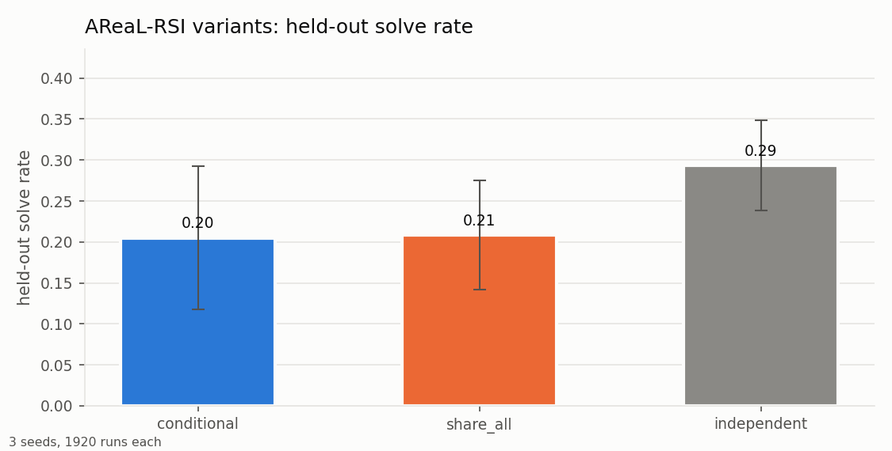

# 10.10 · Leader-follower coordination (AReaL-RSI)

**Group 03 · Scaling RSI** (arXiv:2610.18083) · Previous: [10.09](../10_09_compare_scaling/README.md) · Next: [10.11](../10_11_swarm_rsi/README.md)

> **Question.** Does sharing only *replicated* findings beat sharing everything, or sharing nothing?

## The mechanism, and our adaptation

| Paper | Here |
|---|---|
| leader agent selects task-appropriate research orientations | [`Leader.select`](../../../cipherlab/methods/areal.py#L73): UCB over the four orientations (objective, search, diversify, efficiency), valued by *resolved* gains only |
| conditional memory distinguishes unresolved problems from supported findings | [`ConditionalMemory`](../../../cipherlab/methods/areal.py#L48): a finding is **resolved** only if its gain survives a second-seed rerun ([L160](../../../cipherlab/methods/areal.py#L160)); [`retrieve`](../../../cipherlab/methods/areal.py#L60) returns resolved findings only |
| evidence-based review revises orientation, knowledge and skills | [`Leader.review`](../../../cipherlab/methods/areal.py#L80): updates orientation values, and retires an edit from a skill set after 3 failures ([L96](../../../cipherlab/methods/areal.py#L96)) |
| specialised roles | two researchers, each running a 3-edit greedy campaign inside its assigned orientation ([`_campaign`](../../../cipherlab/methods/areal.py#L108)) |

Variants at one budget, three seeds: **conditional** (the method), **share_all** (adopt any seed-0 gain,
no replication cost), **independent** (no leader, no sharing; each researcher keeps its own program).

## Run it

```bash
python3 labs/03_scaling_coordination/10_10_areal_leader_follower/lab.py           # ~5-8 min
python3 labs/03_scaling_coordination/10_10_areal_leader_follower/lab.py --quick
```

## Output (full run)

<!-- output from="--- Conditional memory" lines=40 -->
```text
--- Conditional memory after seed 0 -----------------------------------------
  c1 R2/search     resolved   gain=+0.083 via ['add_polish(+)', 'use_anneal', 'use_anneal']
  c2 R1/search     unresolved gain=+0.000 via ['use_anneal', 'iters_up', 'iters_down']
  c3 R1/efficiency unresolved gain=+0.000 via ['iters_down', 'remove_polish', 'remove_polish']
  c4 R1/search     unresolved gain=+0.000 via ['remove_polish', 'iters_up', 'iters_up']
  c5 R1/objective  resolved   gain=+0.104 via ['smoothing_down', 'ngram_up', 'add_words(+)']
  c6 R1/objective  unresolved gain=+0.000 via ['smoothing_up', 'words_up', 'smoothing_down']
  c7 R1/objective  resolved   gain=+0.000 via ['smoothing_up', 'words_up', 'vocab_down(+)']
  orientation values: {'objective': 0.026, 'search': 0.017, 'diversify': 0.0, 'efficiency': 0.0}
  skills retired by review: {'objective': ['smoothing_down'], 'search': ['iters_down', 'iters_up', 'remove_polish', 'use_anneal'], 'diversify': ['init_frequency', 'use_anneal'], 'efficiency': ['init_frequency', 'iters_down']}

--- Results -----------------------------------------------------------------
  variant      steering       held-out       campaigns  shared findings
  -----------  -------------  -------------  ---------  ---------------
  conditional  0.312 ± 0.108  0.205 ± 0.107  6.7        4.0            
  share_all    0.306 ± 0.126  0.208 ± 0.082  7.0        3.7            
  independent  0.340 ± 0.064  0.293 ± 0.067  7.0        0.0            

done in 167s
```
<!-- /output -->



## What the numbers say

| Variant (3 seeds, 1,920 runs) | Steering | Held-out | Campaigns | Shared findings |
|---|---|---|---:|---:|
| conditional (replicate, then share) | 0.312 ± 0.108 | 0.205 ± 0.107 | 6.7 | 4.0 |
| share_all | 0.306 ± 0.126 | 0.208 ± 0.082 | 7.0 | 3.7 |
| independent | 0.340 ± 0.064 | **0.293 ± 0.067** | 7.0 | 0 |

- **Sharing does not pay at this budget.** Both team variants trail two independent researchers. A campaign costs
  6–8 evaluations and the team program moves at most once per campaign, so ~7 campaigns give the team ~7 steps,
  where independent researchers each keep improving their own program. The paper's 1.9–27.5% advantage of
  experience sharing is measured over long campaigns with LLM researchers; we do not reproduce it here.
- **Replication costs about as much as it saves.** Conditional and share-all end level (0.205 vs 0.208).
  1–4 campaigns per run ended `unresolved` (no gain, or a gain that did not survive the second seed), but with
  so few campaigns there is little noise to compound.
- **Skill retirement is aggressive.** Even with per-edit credit, the leader retired `use_anneal` and both
  iteration edits from the search orientation after three rejections each. Annealing at its default temperature (2.0)
  often loses early, so it gets retired before the team reaches programs where it would win (lab 10.06 shows it in
  most of the best programs).
- **Two bugs were fixed here** (README, problems 5 and 6): blaming every edit a losing campaign tried, and free
  re-evaluation that let a stuck team loop forever. [Before the fixes](output_before_credit_fix.txt) the numbers were
  0.321 / 0.406 / 0.398, but that run also re-evaluated known programs for free, so it is not a fair comparison.

## Quiz

1. *What does replication cost?* Two extra steering runs per shared finding (child and base on seed 1): fewer edits per campaign at a fixed budget.
2. *What does it buy?* A team program that only moves on gains that survive a new seed, so noise does not compound across campaigns.
3. *Why is "independent" a useful control?* It separates the value of coordination from the value of compute.
