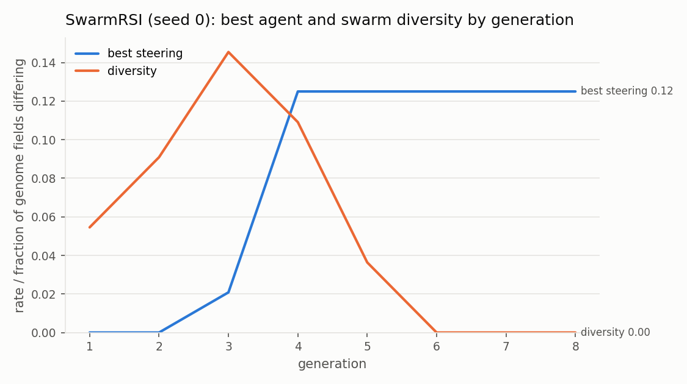

# 10.11 · Swarm evolution (SwarmRSI)

**Group 03 · Scaling RSI** (arXiv:2610.20431) · Previous: [10.10](../10_10_areal_leader_follower/README.md) · Next: [10.12](../../04_adaptive_workflows/10_12_compare_workflows/README.md)

> **Question.** What do mutation, recombination and shared experience each contribute, and what does a swarm buy at equal compute vs equal rounds?

## The mechanism, and our adaptation

Five agents, each with a research **direction** ([`DIRECTIONS`](../../../cipherlab/methods/swarm_rsi.py#L35)) and a
written **hypothesis** ([`HYPOTHESES`](../../../cipherlab/methods/swarm_rsi.py#L45)), each holding an implementation (a program).
One generation of [`run()`](../../../cipherlab/methods/swarm_rsi.py#L88):

1. **Feedback-guided swarm mutation** ([L104](../../../cipherlab/methods/swarm_rsi.py#L104)) — every agent samples one edit from its
   own direction, re-weighted by the swarm's shared experience table (edits that recently helped *anyone* are up to 3× likelier, [L116](../../../cipherlab/methods/swarm_rsi.py#L116)).
2. **Complementary swarm recombination** ([L136](../../../cipherlab/methods/swarm_rsi.py#L136)) — when two or more agents improved *in the same generation*
   by changing *different* fields, their changes are merged into one program ([L143-L145](../../../cipherlab/methods/swarm_rsi.py#L143)) and evaluated once.
3. **Recursive swarm evolution** — each agent's own proposal weights are revised by credit assignment (×1.6 on success, ×0.8 on failure, [L126](../../../cipherlab/methods/swarm_rsi.py#L126)); laggards **migrate** to the leader's program but keep their direction ([L157](../../../cipherlab/methods/swarm_rsi.py#L157)).

Design history worth knowing: the first version had no migration and recombined "best + donor module"; it was
too shallow (each agent got ~7 edits from the 0% baseline) and recombination did nothing because agents never
improved in parallel on a shared base. Migration plus same-generation merging fixed both.

Ablations at one budget: no recombination, no shared experience, no migration. Then the comparison the paper
leaves open: the single-agent loop from 10.06 at **equal compute** and at **equal sequential rounds**.

## Run it

```bash
python3 labs/03_scaling_coordination/10_11_swarm_rsi/lab.py           # ~8-12 min
python3 labs/03_scaling_coordination/10_11_swarm_rsi/lab.py --quick
```

## Output (full run): one generation of the full swarm

<!-- output from="seed 0 · full swarm" lines=16 -->
```text
--- seed 0 · full swarm, every agent's move ---------------------------------
  g1 objective  smoothing_up    -> 0.000 KEEP
  g1 search     iters_down      -> 0.000 drop
  g1 diversify  iters_down      -> 0.000 drop
  g1 efficiency iters_down      -> 0.000 drop
  g1 explorer   smoothing_up    -> 0.000 KEEP
  g2 objective  smoothing_down  -> 0.000 drop
  g2 search     use_anneal      -> 0.000 drop
  g2 diversify  use_anneal      -> 0.000 drop
  g2 efficiency init_frequency  -> 0.000 KEEP
  g2 explorer   smoothing_up    -> 0.000 drop
  g3 objective  smoothing_up    -> 0.000 drop
  g3 search     iters_up        -> 0.021 KEEP
  g3 diversify  init_frequency  -> 0.000 KEEP
  g3 efficiency iters_down      -> 0.000 drop
  g3 explorer   swap_ranked     -> 0.000 drop
...
```
<!-- /output -->

## Output (full run): results

<!-- output from="--- Ablations at equal compute" lines=20 -->
```text
--- Ablations at equal compute ----------------------------------------------
  variant               steering       held-out       sequential rounds  mean diversity
  --------------------  -------------  -------------  -----------------  --------------
  swarm (full)          0.354 ± 0.253  0.288 ± 0.174  7.7                0.06          
  no recombination      0.326 ± 0.209  0.285 ± 0.170  8.0                0.07          
  no shared experience  0.368 ± 0.177  0.259 ± 0.147  7.7                0.05          
  no migration          0.326 ± 0.170  0.293 ± 0.189  7.7                0.20          

--- What a swarm buys: equal compute vs equal sequential rounds -------------
  arm                          runs  sequential rounds  held-out
  ---------------------------  ----  -----------------  --------
  swarm (full)                 1920  8                  0.288   
  single agent, equal compute  1920  40                 0.554   
  single agent, equal rounds   ~416  8                  0.212   

done in 292s
```
<!-- /output -->



## What the numbers say

| Arm (3 seeds) | Steering runs | Sequential rounds | Held-out |
|---|---:|---:|---|
| swarm (full) | 1,920 | ~8 | 0.288 ± 0.174 |
| single agent (naive loop), **equal compute** | 1,920 | 40 | **0.554** |
| single agent, **equal sequential rounds** | ~416 | 8 | 0.212 |

- **At equal compute the swarm loses clearly** (0.288 vs 0.554). Five agents spend five evaluations per round, so the
  leading program gets ~8 sequential improvement attempts where one agent gets 40.
- **At equal sequential rounds the swarm wins** (0.288 vs 0.212). If each round is slow (an LLM agent writing and testing
  a patch) and agents run in parallel, this is the comparison that matches wall-clock time.
- **The ablations are within noise of each other** (held-out 0.259–0.293, sd ≈ 0.15–0.19). With ~8 generations,
  recombination rarely gets two same-generation improvements to merge, and the experience table has few entries.
  Our data cannot separate their contributions; it can only say none of them is large at this budget.
- **Variance is the swarm's real problem here**: seed 0 never left 0.125, seed 1 reached 0.625. With migration every
  agent sits on the same program, so one bad early generation stalls all five.

## Quiz

1. *Why does diversity collapse with migration?* Laggards adopt the leader's program each generation; diversity then lives in the agents' *directions* (what they try), not in their programs.
2. *Is high diversity good?* Not by itself: the no-migration ablation is the most diverse and the shallowest.
3. *What does a swarm buy?* Sequential depth per round. At equal compute it trades sample efficiency for parallelism.
