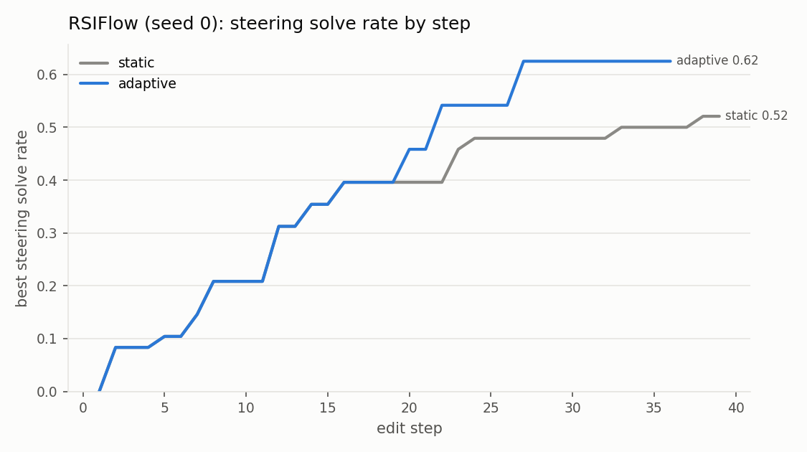

# 10.13 · The RSIFlow meta-agent

**Group 04 · Adaptive workflows** (arXiv:2610.21791) · Previous: [10.12](../10_12_compare_workflows/README.md) · Next: [10.14](../10_14_self_hpo/README.md)

> **Question.** Does a workflow that rewires itself around its bottleneck beat a fixed one?

## The mechanism, and our adaptation

The improvement procedure is a workflow: `PROFILE -> PROPOSE -> SCREEN -> EVALUATE -> INTEGRATE`. The static
arm always runs `PROPOSE -> EVALUATE -> INTEGRATE`. The adaptive arm has a [`MetaAgent`](../../../cipherlab/methods/rsiflow.py#L50)
with four rules that read execution feedback and rewire the workflow:

| Rule | Fires when | Does | Code |
|---|---|---|---|
| `screen_on_low_yield` | < 25% of the last 6 edits accepted | inserts SCREEN: the Budget RSI readout picks 1 of 6 proposals | [L94](../../../cipherlab/methods/rsiflow.py#L94) |
| `profile_on_stall` | 4 rejections in a row | runs PROFILE (a probe) and restricts PROPOSE to its remedies for 4 steps | [L98](../../../cipherlab/methods/rsiflow.py#L98) |
| `cap_guard` | most runs hit the harness cap | bans "search longer" edits | [L104](../../../cipherlab/methods/rsiflow.py#L104) |
| `drop_dead_target` | a target with 4 failures, 0 wins | damps that target ×0.15 | |

The meta-agent **evolves**: each rule's usefulness is the mean gain of steps it shaped minus that of steps no
rule touched; a rule still negative after 3 activations is switched off ([`evolve`](../../../cipherlab/methods/rsiflow.py#L59)).
That is the "evolving meta-agent" in miniature: the orchestration learns from its own execution feedback.

## Run it

```bash
python3 labs/04_adaptive_workflows/10_13_rsiflow_meta_agent/lab.py           # ~5-8 min
python3 labs/04_adaptive_workflows/10_13_rsiflow_meta_agent/lab.py --quick
```

## Output (full run)

<!-- output from="seed 0 · adaptive" lines=45 -->
```text
--- seed 0 · adaptive workflow changes --------------------------------------
  step 01 workflow: PROPOSE -> EVALUATE -> INTEGRATE
    PROFILE: ['cap_bound', 'short_texts'] -> remedies ['init_frequency', 'restarts_down', 'use_anneal', 'remove_polish']
  step 27 workflow: PROFILE -> PROPOSE[7 remedies] -> SCREEN -> EVALUATE -> INTEGRATE
  step 30 workflow: PROPOSE -> SCREEN -> EVALUATE -> INTEGRATE
    PROFILE: ['local_optima', 'cap_bound', 'short_texts', 'high_variance'] -> remedies ['use_anneal', 'restarts_up', 'init_frequency', 'temp_up']
  step 32 workflow: PROFILE -> PROPOSE[9 remedies] -> SCREEN -> EVALUATE -> INTEGRATE
  step 35 workflow: PROPOSE -> SCREEN -> EVALUATE -> INTEGRATE
    PROFILE: ['local_optima', 'cap_bound', 'short_texts', 'high_variance'] -> remedies ['use_anneal', 'restarts_up', 'init_frequency', 'temp_up']
  step 36 workflow: PROFILE -> PROPOSE[9 remedies] -> SCREEN -> EVALUATE -> INTEGRATE
  seed 0 adaptive  final=0.625  4-gram words×2 freq anneal T4 polish 8x4000
  seed 1 static    final=0.583  2-gram words×2 freq anneal T2 8x8000
  seed 1 adaptive  final=0.521  2-gram words×2 rand anneal T2 8x4000
  seed 2 static    final=0.625  3-gram words×2 freq anneal T8 k=0.1 4x8000
  seed 2 adaptive  final=0.688  3-gram words×2 freq anneal T4 k=0.1 2x16000

--- Meta-agent rules after each adaptive run --------------------------------
  screen_on_low_yield: on x1 u=-0.016; profile_on_stall: OFF x3 u=-0.015; cap_guard: on x1 u=-0.013; drop_dead_target: on x0 u=+0.000
  screen_on_low_yield: on x1 u=-0.038; profile_on_stall: OFF x3 u=-0.038; cap_guard: on x1 u=-0.038; drop_dead_target: on x0 u=+0.000
  screen_on_low_yield: on x1 u=-0.018; profile_on_stall: OFF x3 u=-0.006; cap_guard: on x1 u=-0.018; drop_dead_target: on x0 u=+0.000

--- Results -----------------------------------------------------------------
  workflow  steering       held-out       edit steps
  --------  -------------  -------------  ----------
  static    0.576 ± 0.052  0.554 ± 0.090  39.0      
  adaptive  0.611 ± 0.084  0.575 ± 0.097  36.0      

done in 298s
```
<!-- /output -->



## What the numbers say

| Workflow (3 seeds, 1,920 runs) | Steering | Held-out |
|---|---|---|
| static | 0.576 ± 0.052 | 0.554 ± 0.090 |
| adaptive (meta-agent) | 0.611 ± 0.084 | **0.575 ± 0.097** |

- **A small gain, within one standard deviation**: +0.021 held-out on average (seed 2: 0.688 steering vs 0.625).
- **The workflow only starts to change late.** In seed 0 the first rewiring happens at step 27, when the program hits
  the evaluation cap and acceptances dry up; then SCREEN, PROFILE and the cap guard switch on together.
- **The meta-agent edits itself.** In all three runs it switched `profile_on_stall` OFF after three activations whose
  following steps gained less than untouched steps (usefulness −0.006 to −0.038). The run that removed a rule is the
  "evolving meta-agent" behaviour, measured.
- **Caveat on that judgement:** rules fire exactly when progress is hardest, so comparing their steps to earlier
  untouched steps is biased against them. A fair test would need a concurrent control arm.

## Quiz

1. *Why measure rule usefulness against untouched steps?* A rule that fires late (when gains are naturally smaller) would otherwise look harmful; comparing against concurrent untouched steps is a crude control.
2. *What does SCREEN cost?* Nothing at evaluation time (the readout is trained once); it changes which edit is evaluated.
