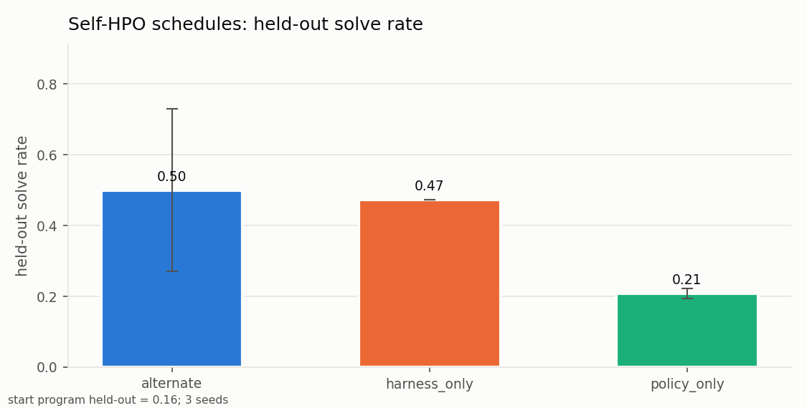

# 10.14 · Self-HPO: harness/policy alternation

**Group 04 · Adaptive workflows** (arXiv:2610.22791) · Previous: [10.13](../10_13_rsiflow_meta_agent/README.md) · Next: [10.15](../../05_environments_metrics/10_15_rsi_index/README.md)

> **Question.** Is optimising harness and policy together worth more than the sum of each alone?

## The mechanism, and our adaptation

| Paper | Here |
|---|---|
| harness: the agent's scaffold | discrete fields: init, search rule, polish, swap moves, restarts, iterations ([`HARNESS_OPS`](../../../cipherlab/methods/self_hpo.py#L38)) |
| policy: model weights, updated by RL | continuous scorer weights: word weight, annealing temperature, n-gram smoothing |
| **H-step**: the policy analyses its failures and proposes harness candidates | [`h_step`](../../../cipherlab/methods/self_hpo.py#L43): failing steering ciphers become the *hard set* ([L47](../../../cipherlab/methods/self_hpo.py#L47)); the policy's own failure analysis ranks harness edits ([L51](../../../cipherlab/methods/self_hpo.py#L51)); the top 3 run on the hard set; the winner must also beat the program on all 48 |
| **P-step**: RL under the selected harness | [`p_step`](../../../cipherlab/methods/self_hpo.py#L71): an evolution strategy, 4 log-normal perturbations of the policy weights |

Start program: `3-gram words×1 rand hill 2x2000` (so both halves have something to tune). Three schedules at
one budget, three seeds: **alternate**, **harness_only**, **policy_only**. The synergy check compares the joint
held-out gain with the sum of the two separate gains.

## Run it

```bash
python3 labs/04_adaptive_workflows/10_14_self_hpo/lab.py           # ~5-8 min
python3 labs/04_adaptive_workflows/10_14_self_hpo/lab.py --quick
```

## Output (full run)

<!-- output from="seed 0 · alternate" lines=50 -->
```text
--- seed 0 · alternate ------------------------------------------------------
  H1: H: init_frequency (from ['local_optima', 'short_texts']) solves 6/37 hard -> 0.229
  P2: P: 4 policy perturbations -> moved -> 0.229
  H3: H: use_anneal (from ['short_texts']) solves 6/37 hard -> 0.250
  P4: P: 4 policy perturbations -> moved -> 0.375
  H5: H: restarts_up (from ['local_optima', 'short_texts']) solves 5/30 hard -> 0.479
  P6: P: 4 policy perturbations -> stayed -> 0.479
  H7: H: iters_up (from ['local_optima', 'short_texts']) solves 7/25 hard -> 0.625
  P8: P: 4 policy perturbations -> stayed -> 0.625
  H9: H: init_random won on hard set but lost on full steering -> 0.625
  P10: P: 4 policy perturbations -> stayed -> 0.625

--- seed 0 · harness_only ---------------------------------------------------
  H1: H: init_frequency (from ['local_optima', 'short_texts']) solves 6/37 hard -> 0.229
  H2: H: use_anneal (from ['local_optima', 'short_texts']) solves 7/37 hard -> 0.292
  H3: H: iters_up (from ['local_optima', 'undersearched']) solves 10/34 hard -> 0.417
  H4: H: init_random won on hard set but lost on full steering -> 0.417
  H5: H: restarts_up (from ['local_optima', 'short_texts']) solves 5/28 hard -> 0.521
  H6: H: iters_up (from ['local_optima', 'short_texts']) solves 6/23 hard -> 0.521
  H7: H: iters_up won on hard set but lost on full steering -> 0.521
  H8: H: iters_down won on hard set but lost on full steering -> 0.521
  H9: H: iters_up won on hard set but lost on full steering -> 0.521
  H10: H: init_random (from ['cap_bound', 'short_texts']) solves 8/23 hard -> 0.542
  H11: H: init_frequency won on hard set but lost on full steering -> 0.542
  H12: H: init_frequency won on hard set but lost on full steering -> 0.542
  H13: H: init_frequency won on hard set but lost on full steering -> 0.542

--- seed 0 · policy_only ----------------------------------------------------
  P1: P: 4 policy perturbations -> moved -> 0.250
  P2: P: 4 policy perturbations -> stayed -> 0.250
  P3: P: 4 policy perturbations -> stayed -> 0.250
  P4: P: 4 policy perturbations -> moved -> 0.292
  P5: P: 4 policy perturbations -> stayed -> 0.292
  P6: P: 4 policy perturbations -> stayed -> 0.292
  P7: P: 4 policy perturbations -> stayed -> 0.292
  P8: P: 4 policy perturbations -> stayed -> 0.292
  P9: P: 4 policy perturbations -> stayed -> 0.292
  P10: P: 3 policy perturbations -> stayed -> 0.292
  seed 1 alternate    0.229 -> 0.688  3-gram words×1.279 freq anneal T4.618 k=0.1 8x4000
  seed 1 harness_only 0.229 -> 0.542  3-gram words×1 rand anneal T2 4x8000
  seed 1 policy_only  0.229 -> 0.292  3-gram words×1.814 rand hill 2x2000
  seed 2 alternate    0.229 -> 0.292  3-gram words×1.887 rand hill 2x2000
  seed 2 harness_only 0.229 -> 0.542  3-gram words×1 rand anneal T2 4x8000
  seed 2 policy_only  0.229 -> 0.271  3-gram words×1.205 rand hill k=1 2x2000

--- Results -----------------------------------------------------------------
  schedule      steering       held-out       held-out gain
  ------------  -------------  -------------  -------------
  alternate     0.535 ± 0.213  0.500 ± 0.280  +0.339       
  harness_only  0.542 ± 0.000  0.474 ± 0.000  +0.312       
...
```
<!-- /output -->



## What the numbers say

| Schedule (3 seeds, 1,920 runs) | Steering | Held-out | Held-out gain over the start (0.161) |
|---|---|---|---|
| alternate (H, P, H, P…) | 0.535 ± 0.213 | **0.500 ± 0.280** | +0.339 |
| harness only | 0.542 ± 0.000 | 0.474 ± 0.000 | +0.312 |
| policy only | 0.285 ± 0.012 | 0.208 ± 0.018 | +0.047 |

- **The harness carries almost all of the gain.** Policy-only tuning (weights and temperature on a hill climber)
  moves held-out by +0.05; harness edits (annealing, restarts, iterations) by +0.31.
- **No synergy at this scale:** the joint gain (+0.339) is slightly *below* the sum of the separate gains (+0.359),
  so the paper's "joint > sum" claim is not reproduced here. Alternation is the best schedule on average, but with
  huge variance: seed 1 reaches 0.688 steering (the best program in this lab), seed 2 only 0.292.
- **Why harness-only has zero spread:** its H-step is deterministic once the diagnosis is fixed (it ranks candidates
  by the policy's own failure analysis), so all three seeds take the same path. Randomness enters only through
  P-steps, which is where alternate's variance comes from.
- **A guard earned its place:** in seed 0, H9 found `init_random` best on the 25 hard ciphers but it *lost* on the full
  split, so it was rejected. Targeting the hard set alone would have overfit to it.

## Quiz

1. *Why evaluate H-step candidates on the hard set first?* It is cheaper (only failing ciphers) and targeted: a harness edit that does not help the current failures is unlikely to help at all.
2. *Why require the winner to beat the program on the full split?* A harness that fixes hard ciphers can break easy ones.
