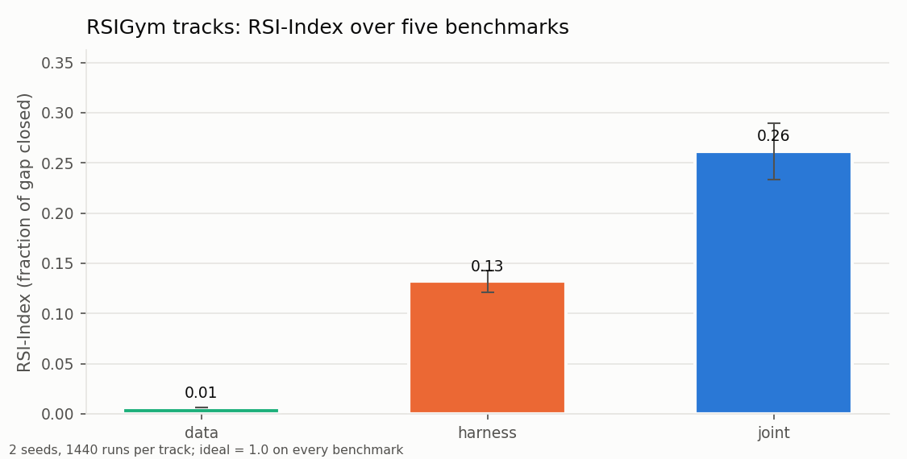

# 10.15 · Calculate the RSI-Index (RSIGym)

**Group 05 · Environments and metrics** (arXiv:2610.10310) · Previous: [10.14](../../04_adaptive_workflows/10_14_self_hpo/README.md) · Next: [10.16](../10_16_environments/README.md)

> **Question.** What fraction of the remaining gap does each improvement track close, across benchmarks?

## The formula, and a typo

The course page prints `RSI-Index = mean((initial - final) / (ideal - initial))` but its own worked example
computes `(75 - 50) / (100 - 50) = 0.5`, i.e. `final - initial`. With the printed sign every improvement is
negative. The lab computes both on the page's example; [`rsi_index`](../../../cipherlab/methods/rsigym.py#L143)
uses the corrected form and [`rsi_index_as_printed`](../../../cipherlab/methods/rsigym.py#L148) is kept for the comparison.

## RSIGym in miniature

[`RSIGym`](../../../cipherlab/methods/rsigym.py#L71) is Everything-as-a-Service: the improver never touches the
evaluator; it calls `sandbox`, `rollout`, `evaluate` and `train` through [`_gate`](../../../cipherlab/methods/rsigym.py#L78),
which checks the track's permissions ([`PermissionDenied`](../../../cipherlab/methods/rsigym.py#L80)) and charges one budget.

| Track | May change | May call |
|---|---|---|
| data | objective and data: n-gram order, dictionary, smoothing, vocabulary | sandbox, train, evaluate |
| harness | search, init, efficiency | sandbox, rollout, evaluate |
| joint | everything | all four |

Each track improves the baseline on the `sherlock` benchmark only; every final program is then scored on five
[benchmarks](../../../cipherlab/methods/rsigym.py#L51): sherlock, short_only, patristocrat (no word spaces),
tight_budget (cap 5,000 instead of 20,000) and the sealed frankenstein held-out.

## Run it

```bash
python3 labs/05_environments_metrics/10_15_rsi_index/lab.py           # ~4-6 min
python3 labs/05_environments_metrics/10_15_rsi_index/lab.py --quick
```

## Output (full run)

<!-- output from="--- 3. Scores per benchmark" lines=14 -->
```text
--- 3. Scores per benchmark and RSI-Index -----------------------------------
  track     sherlock  short_only  patristocrat  tight_budget  frankenstein  RSI-Index    
  --------  --------  ----------  ------------  ------------  ------------  -------------
  baseline  0.000     0.000       0.010         0.000         0.000         0            
  data      0.010     0.000       0.010         0.010         0.010         0.006 ± 0.000
  harness   0.219     0.000       0.135         0.089         0.227         0.132 ± 0.011
  joint     0.385     0.048       0.266         0.266         0.352         0.262 ± 0.028

  'frankenstein' is the sealed held-out benchmark; the other four were reachable during search only via 'sherlock'.
  short_only and patristocrat show transfer: a track that only tuned for spaced, mixed-length text may not help there.

done in 75s
```
<!-- /output -->



## What the numbers say

| Track | sherlock | short_only | patristocrat | tight_budget | frankenstein (held-out) | RSI-Index |
|---|---|---|---|---|---|---|
| baseline | 0.000 | 0.000 | 0.010 | 0.000 | 0.000 | 0 |
| data | 0.010 | 0.000 | 0.010 | 0.010 | 0.010 | 0.006 ± 0.000 |
| harness | 0.219 | 0.000 | 0.135 | 0.089 | 0.227 | 0.132 ± 0.011 |
| joint | 0.385 | 0.048 | 0.266 | 0.266 | 0.352 | **0.262 ± 0.028** |

- **Joint beats the sum of its parts** (0.262 vs 0.006 + 0.132): the same direction as the paper's "joint
  track outperforms data-only or harness-only". A better language model is useless to a solver that cannot
  search (the data track alone stays near zero), and a better search is capped by a weak objective.
- **Transfer is uneven, and the index hides it.** No track helps short ciphers much (0.048 at best) and the
  patristocrat benchmark (no word spaces, so no dictionary signal) gets less than half the Sherlock gain.
- **The printed formula's sign** turns the course example's +0.5 into −0.5; every track here would score negative.

## Quiz

1. *Why normalise by the remaining gap?* A 10-point gain from 85% is harder than from 10%; the index credits closing a share of what was left.
2. *What does the index hide?* Which benchmark moved. A track can score well on average while doing nothing on patristocrat.
