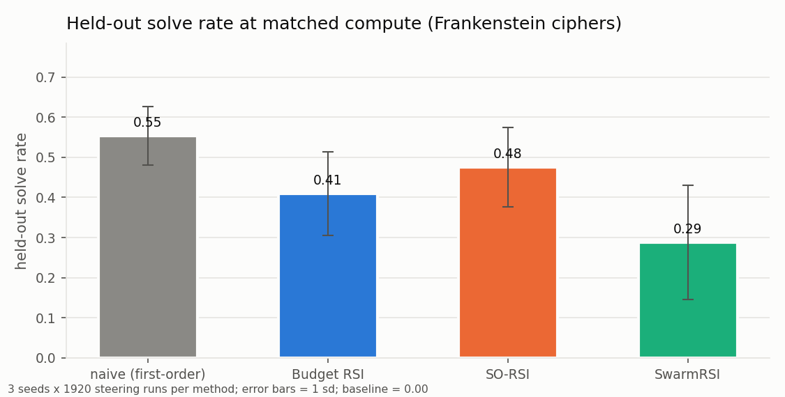

# Finale · Three RSI methods, one problem, one budget

**After Group 05** · Previous: [10.17](../../05_environments_metrics/10_17_metrics/README.md) · [Back to the README](../../../README.md)

> **Question.** Under matched compute, which improvement procedure produces the best cipher breaker on unseen text?

The three methods this repo rebuilds, plus the first-order loop as the reference, each improve the same baseline
with the same number of steering instance-runs over the same seeds:

| Method | Implementation | What it changes about improvement |
|---|---|---|
| naive (first order) | [`so_rsi.run(second_order=False)`](../../../cipherlab/methods/so_rsi.py#L121) | nothing: sample, test, keep |
| **Budget RSI** | [`budget_rsi.run(selector="readout")`](../../../cipherlab/methods/budget_rsi.py#L176) | *which* edit is worth evaluating (readout) and *where* to branch (HGM) |
| **SO-RSI** | [`so_rsi.run(second_order=True)`](../../../cipherlab/methods/so_rsi.py#L121) | *why* edits fail (probes) and how the proposer adapts (inquiry memory) |
| **SwarmRSI** | [`swarm_rsi.run()`](../../../cipherlab/methods/swarm_rsi.py#L88) | *who* proposes (five directions), how progress is merged and shared |

Held-out stays sealed until every search has finished; the auditor ([`audit()`](../../../cipherlab/audit.py#L17))
then checks the evaluator's ledger. Each final program is also scored on all five RSIGym benchmarks and summarised
with the RSI-Index.

## Run it

```bash
python3 labs/06_finale/three_methods_showdown/lab.py           # ~8-12 min
python3 labs/06_finale/three_methods_showdown/lab.py --quick   # ~1 min
```

## Output (full run)

<!-- output from="--- Audit" lines=30 -->
```text
--- Audit -------------------------------------------------------------------
  [PASS] sealed held-out  held-out touched only in the final report
  [PASS] matched budgets  naive (first-order): 1920-1920 runs, Budget RSI: 1920-1920 runs, SO-RSI: 1920-1920 runs, SwarmRSI: 1920-1920 runs
  [PASS] enough seeds     naive (first-order): 3, Budget RSI: 3, SO-RSI: 3, SwarmRSI: 3
  [PASS] gap reported     steering and held-out recorded for every run

--- Results -----------------------------------------------------------------
  method               steering       held-out (Frankenstein)  RSI-Index (5 benchmarks)  runs
  -------------------  -------------  -----------------------  ------------------------  ----
  naive (first-order)  0.576 ± 0.052  0.554 ± 0.090            0.381 ± 0.061             1920
  Budget RSI           0.465 ± 0.105  0.410 ± 0.127            0.263 ± 0.054             1920
  SO-RSI               0.556 ± 0.060  0.476 ± 0.120            0.315 ± 0.112             1920
  SwarmRSI             0.354 ± 0.253  0.288 ± 0.174            0.191 ± 0.118             1920

--- Best program found, per method ------------------------------------------
  naive (first-order)  0.651  3-gram words×2 freq anneal T8 k=0.1 4x8000
  Budget RSI           0.521  2-gram words×1 freq hill polish k=1 8x2000
  SO-RSI               0.589  3-gram words×4 freq anneal T8 4x8000
  SwarmRSI             0.443  2-gram words×2 rand anneal T2 polish k=0.1 vocab=1000 8x2000

  baseline program held-out: 0.000; audit passed

done in 613s
```
<!-- /output -->



## What the numbers say

| Method (3 seeds × 1,920 steering runs) | Steering | Held-out (96 Frankenstein ciphers) | RSI-Index (5 benchmarks) | Best single program, held-out |
|---|---|---|---|---|
| naive first-order loop | 0.576 ± 0.052 | **0.554 ± 0.090** | **0.381 ± 0.061** | 0.651 |
| SO-RSI | 0.556 ± 0.060 | 0.476 ± 0.120 | 0.315 ± 0.112 | 0.589 |
| Budget RSI | 0.465 ± 0.105 | 0.410 ± 0.127 | 0.263 ± 0.054 | 0.521 |
| SwarmRSI | 0.354 ± 0.253 | 0.288 ± 0.174 | 0.191 ± 0.118 | 0.443 |
| baseline program | 0.000 | 0.000 | 0 | |

All four arms passed the audit: held-out untouched until the report, identical budgets, 3 seeds, both splits recorded.

**The plain first-order loop wins at this budget, and none of the three October 2026 methods beat it on held-out.**
That is the result, and it does not contradict the papers so much as locate their assumptions:

- **SO-RSI** ties the loop on steering (0.556 vs 0.576) and trails on held-out. Its probes cost ~17% of the budget
  (6.7 probes × 48 runs on average) and, in this domain, the symptom-driven prior is already a good guess early on: "search harder"
  *is* the right first fix for a program that does 1,000 swaps. Diagnosis pays when the obvious fix is wrong,
  which happens late here (the cap), not early.
- **Budget RSI** does what its paper claims, relative to its own ablation: reading diffs doubles held-out over
  random selection in the same tree (0.410 vs 0.215, lab 10.03). But a Huxley-Gödel tree spreads 40 evaluations
  across many branches; a greedy chain spends them on one. It also proposes from the uniform edit prior (that is
  what its readout was trained on), while naive and SO-RSI share the symptom prior that suits this domain.
- **SwarmRSI** at equal compute gets ~8 sequential rounds to the loop's 40. At equal rounds it wins (lab 10.11).
- **Variance dominates the differences between methods.** Every method's sd is 0.09–0.17 on held-out. With 3 seeds,
  the only gap clearly larger than the spread is the first-order loop over SwarmRSI at equal compute (0.554 vs 0.288).

What would change the ranking, and is not tested here: an LLM proposer (whose first guess is less reliable than
our prior), larger budgets (where the cap and objective bottlenecks dominate and diagnosis matters more), and
slow agents (where SwarmRSI's sequential depth is what counts).
